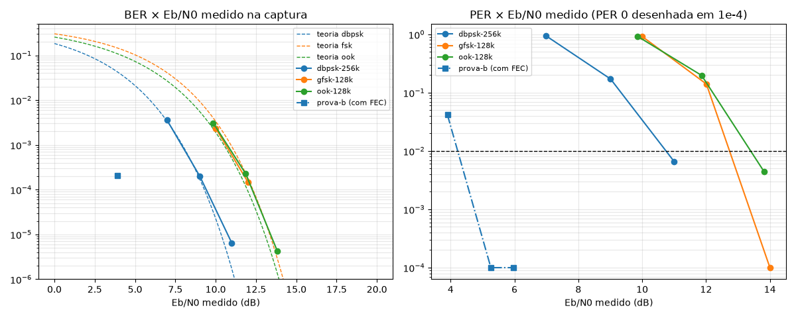

# Análise da sessão bancada_simulada_20261122_153017

Versão do código: `bloco-19-4-g7a5e2f0`. 12 pontos; perda do enlace em relação à teoria: mediana de +0.07 dB (6 pontos sem FEC e com pelo menos 10 erros contados).

| Captura | Perfil | Ganho RX (dB) | Eb/N0 medido (dB) | BER | PER | Goodput (kbit/s) | Banda (kHz) | Offset (Hz) | Perda (dB) |
|---|---|---|---|---|---|---|---|---|---|
| dbpsk-256k_07.0dB.npy | dbpsk-256k | sem dado | 6.98 | 3.61e-03 | 95.15% | 11.3 | 296.4 | -1390 | +0.05 |
| dbpsk-256k_09.0dB.npy | dbpsk-256k | sem dado | 9.01 | 2.02e-04 | 17.18% | 192.5 | 297.7 | -1359 | +0.08 |
| dbpsk-256k_11.0dB.npy | dbpsk-256k | sem dado | 11.00 | 6.45e-06 | 0.66% | 230.9 | 294.8 | -1398 | sem dado |
| gfsk-128k_10.0dB.npy | gfsk-128k | sem dado | 10.00 | 2.36e-03 | 92.07% | 9.2 | 211.0 | -1427 | -0.30 |
| gfsk-128k_12.0dB.npy | gfsk-128k | sem dado | 12.01 | 1.46e-04 | 14.10% | 99.8 | 217.7 | -1430 | -0.10 |
| gfsk-128k_14.0dB.npy | gfsk-128k | sem dado | 14.00 | 0.00e+00 | 0.00% | 116.2 | 212.3 | -1424 | sem dado |
| ook-128k_10.0dB.npy | ook-128k | sem dado | 9.85 | 3.08e-03 | 92.95% | 8.2 | 143.7 | -1545 | +0.27 |
| ook-128k_12.0dB.npy | ook-128k | sem dado | 11.86 | 2.28e-04 | 19.82% | 93.2 | 143.8 | -1518 | +0.37 |
| ook-128k_14.0dB.npy | ook-128k | sem dado | 13.82 | 4.30e-06 | 0.44% | 115.7 | 141.9 | -1503 | sem dado |
| prova-b_04.0dB.npy | prova-b | sem dado | 3.90 | 2.03e-04 | 4.17% | 11.8 | 186.0 (não confiável) | -1385 | sem dado |
| prova-b_05.0dB.npy | prova-b | sem dado | 5.26 | 0.00e+00 | 0.00% | 12.3 | 1721.6 (não confiável) | -1394 | sem dado |
| prova-b_06.0dB.npy | prova-b | sem dado | 5.96 | 0.00e+00 | 0.00% | 12.3 | 208.4 (não confiável) | -1381 | sem dado |

