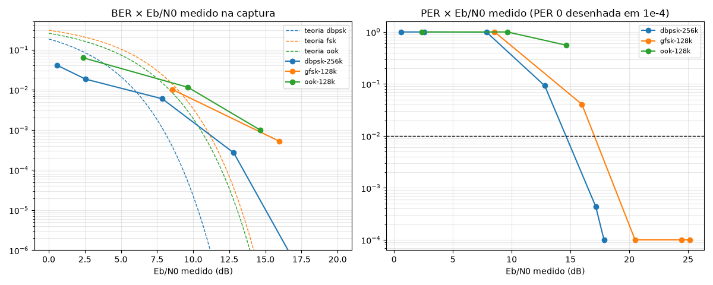

# Bancada de 25/11/2026: sessão 1 no laboratório e ensaio em casa

Primeira sessão com o Pluto e o RTL da equipe depois de tudo o que fizemos sem hardware (blocos 06 a 25). De manhã no laboratório, à tarde em casa com o mesmo Pluto e o RTL trocado. Este documento junta o que medi, os defeitos que a bancada achou e as correções (bloco 26).

## 1. Montagem

| Item | Laboratório (manhã) | Casa (tarde) |
|---|---|---|
| TX | Pluto da equipe, `ip:192.168.2.22`, antena da caixa | o mesmo |
| RX | RTL1 até 10:50, depois RTL2 | RTL2 |
| Distância | cerca de 1 m, mesa | cerca de 1 m, mesa |
| Correção do RTL | RTL1 +56 ppm; RTL2 +87 ppm (frio) | RTL2 +88 ppm (aquecido), em `configs/rtl.toml` |

O enlace em casa ficou cerca de 6,5 dB mais fraco que o do laboratório com a mesma atenuação no Pluto (posição das antenas e ambiente).

## 2. Resultados

### 2.1 Prova A (DQPSK, `prova-a`, 60 s)

| Ensaio | TX | Certos / transmitidos | PER | Goodput | Eb/N0 | Banda a 99% |
|---|---|---|---|---|---|---|
| Laboratório, sem `--pre-gerar` | −30 dB | 45 230 / 71 359 | 36,6% | 771,9 kbit/s | 17,2 dB | 754,2 kHz |
| Laboratório, `--pre-gerar` | −30 dB | 70 939 / 71 359 | 0,59% | 1 210,7 kbit/s | 20,2 dB | 749,5 kHz |
| Laboratório, `--pre-gerar` e a espera da fila | −30 dB | 71 347 / 71 359 | **0,017%** | **1 217,7 kbit/s** | 18,4 dB | 748,0 kHz |
| Casa, arquivo cifrado de 9,5 MB, `prova_tx`/`prova_rx` | −30 dB | 32 335 / 71 359 | 54,7% | 551,9 kbit/s | 12,1 dB | 737,9 kHz |
| Casa, o mesmo | −20 dB | 71 335 / 71 359 | **0,034%** | **1 217,5 kbit/s** | 21,2 dB | 747,4 kHz |

O goodput de 1 217,7 kbit/s é o do ensaio geral simulado (1 217,8 kbit/s): no ar a DQPSK chegou ao teto do perfil. A banda medida no RTL, de 748 kHz, bate com a simulação (748,6 kHz).

### 2.2 Prova B (DBPSK com FEC, `prova-b`)

| Ensaio | TX | Certos / transmitidos | PER |
|---|---|---|---|
| Laboratório, 60 s, 919,75 MHz | −30 dB | 694 / 694 | 0 |
| Laboratório, 20 s, 919,75 MHz, RTL1 | −55 / −60 / −64 dB | 218 / 189 / 0 de 232 | 6,0% / 18,5% / 100% |
| Laboratório, 20 s, 919,75 MHz, RTL2 | −55 / −60 dB | 222 / 199 de 232 | 4,3% / 14,2% |
| Casa, 20 s, 919,75 MHz | −49 / −52 / −55 dB | 232 / 217 / 142 de 232 | 0 / 6,5% / 38,8% |
| Casa, 20 s, **919,875 MHz** (375 kHz) | −52 dB | 232 / 232 | **0** |
| Casa, 60 s, 919,875 MHz, `prova_tx`/`prova_rx` | −40 / −50 / −53 dB | 694 / 694 em cada | 0 |
| Casa, o mesmo | −57 dB | 519 / 694 | 25,2% |

As perdas a 919,75 MHz vinham em rajadas, sempre no mesmo ponto do espectro: ver o defeito 5 abaixo.

### 2.3 Ruído de fase (tom do Pluto no RTL)

| RTL | L(f) de 1 a 300 kHz | Prova A (tolera 0,096 rad) | 8-PSK (tolera 0,157 rad em 0,39 ms) |
|---|---|---|---|
| RTL1 | −74 a −82 dBc/Hz e duas raias a ±1,7 kHz com −8 dBc | 0,006 a 0,008 rad: ok | **0,87 rad: ATENÇÃO** |
| RTL2 | −78 a −80 dBc/Hz, raias abaixo de −58 dBc | 0,005 rad: ok | 0,030 rad: ok |

Registros: `dados/capturas/sessao_20261125/tom_*_ruido_de_fase.json` (RTL1) e `dados/calibracao/calibracao_20261125_110659_depois_ruido_de_fase.json` (RTL2).

## 3. Defeitos que a bancada achou

| # | Defeito | Como apareceu | Correção | Teste |
|---|---|---|---|---|
| 1 | **O TX não acompanha o tempo real** (risco R1): gerando o sinal durante a transmissão, 60 s de sinal levaram 99 s, com buracos | prova A com 36,6% de PER | `--pre-gerar` sempre no dia da prova (o `prova_tx.py` já usa) e `--atraso-s`: o TX avisa "Sinal pronto" e conta até ir ao ar | `test_transmissor.py` |
| 2 | **O fim da transmissão era cortado**: a libiio ainda tinha 4 buffers na fila quando o programa desligava o Pluto | os últimos 0,35 s da prova A sumiam | espera da fila (`BUFFERS_NA_FILA × tamanho / taxa + 0,1 s`) antes de desligar | `test_transmissor.py` |
| 3 | **O `receber.py` caía na medida da banda** quando o TX ligava no meio da gravação: o surto de partida entrava na estimativa do ruído | Traceback depois de decodificar tudo | `ruido_limpo` descarta os blocos de 50 ms com mais que o dobro da potência mediana; `try/except` em volta da medida | `test_medicao.py` |
| 4 | **RTL1 com o oscilador modulado em 1,7 kHz** (raias de −8 dBc) | ruído de fase da 8-PSK 5,5 vezes acima do tolerado | RTL trocado; o RTL1 não deve ser usado na prova | sessão 1 |
| 5 | **Aparelhos ISM em surtos numa grade de 500 kHz** (919,25 e 919,75 MHz), no laboratório e em casa | perdas em rajadas na prova B a 919,75 MHz | prova B movida para 375 kHz (919,875 MHz); `escolher_canal.py` mede os candidatos sem o TX | `test_prova.py` |
| 6 | **`gravar_iq.py` com ponto no nome**: o `with_suffix` cortava o nome no ponto e duas gravações caíam no mesmo arquivo | `--nome var_919.12` | o ponto do nome vira "_" | `test_prova.py` |
| 7 | **A librtlsdr falha ao fechar o RTL** (access violation no `rtlsdr_close`) depois de a leitura terminar completa | 4 de 18 gravações perdidas na varredura da Etapa 5 | a falha ao fechar vira aviso e a gravação é mantida (`rtl_rx.fechar`) | `test_rtl_rx.py` |
| 8 | **`prova_rx.py` caía num PowerShell comum**: o `receber.py` filho escrevia em cp1252 e o pai lia em UTF-8 | ao reprocessar uma gravação fora dos meus scripts de ensaio | os filhos rodam com `PYTHONIOENCODING=utf-8` | `test_prova.py` |
| 9 | **Surto na partida do Pluto** (0,4 a 0,7 s perto da saturação) | gravação começando antes do TX | não corrigido: some antes do primeiro quadro e não derruba pacotes; o RX ignora na medida (defeito 3) | |

## 4. Ferramentas do dia da prova (bloco 26)

Com o que a bancada mostrou, juntei o dia da competição em quatro scripts ([roteiro_da_prova.md](roteiro_da_prova.md), seção 0): `prova_tx.py` (arquivo do professor, de qualquer tipo, em payloads de 128 bytes, sempre com `--pre-gerar`), `prova_rx.py` (grava, decodifica, remonta o arquivo, relatório com gráfico, PER e goodput sem o log do TX), `relatorio_alcance.py` (goodput e PER por distância na prova B) e `escolher_canal.py`.

## 5. Etapa 5 e 8-PSK no ar com o RTL2

### 5.1 Varredura da Etapa 5 (casa, 16:04 a 16:15)

Três modulações com payloads conhecidos (BER), 10 s cada, TX de −28 a −48 dB, RTL2 com ganho de 25 dB (18 dB no nível mais forte). Análise automática pelo `analisar_bancada.py`: `dados/logs/etapa5_casa_analise_bancada.md`.

| Perfil | TX | Eb/N0 estimado | BER | PER | Goodput | Banda a 99% |
|---|---|---|---|---|---|---|
| `dbpsk-256k` | −28 dB | 17,9 dB | 0 | 0 | 232,0 kbit/s | 286,9 kHz |
| | −34 dB | 17,1 dB | 4,3 × 10⁻⁷ | 0,04% | 231,9 kbit/s | 265,0 kHz |
| | −38 dB | 12,8 dB | 2,7 × 10⁻⁴ | 9,2% | 210,6 kbit/s | 240,0 kHz |
| | −42 dB | 7,9 dB | 6,0 × 10⁻³ | 99,1% | 2,0 kbit/s | |
| `gfsk-128k` | −28 a −38 dB | 25,1 a 20,5 dB | 0 | 0 | 116,1 kbit/s | 198,8 kHz (−28 dB) |
| | −42 dB | 16,0 dB | 5,2 × 10⁻⁴ | 4,1% | 111,4 kbit/s | |
| | −48 dB | 8,6 dB | 1,0 × 10⁻² | 100% | 0 | |
| `ook-128k` | −38 dB | 14,7 dB | 9,9 × 10⁻⁴ | 55,6% | 51,6 kbit/s | 115,9 kHz |
| | −42 dB | 9,6 dB | 1,2 × 10⁻² | 100% | 0 | |

O que tiro daqui:
1. **A ordem das modulações é a da teoria.** No mesmo nível de TX (−38 dB), a DBPSK com o dobro da taxa perde 9% dos pacotes, a GFSK nenhum, e a OOK mais da metade. A −42 dB a GFSK ainda passa 96% e as outras duas param.
2. **A perda do enlace em relação à teoria** tem mediana de +1,4 dB, mas os pontos com PER entre 4% e 60% (os mais confiáveis: muitos erros contados e quase todos os quadros detectados) ficam de +4,0 a +4,6 dB. Os pontos com PER de 100% dão perda negativa porque a BER só é contada nos quadros que o receptor achou, e esses são os de sorte. A mesma diferença de cerca de 3 a 4 dB apareceu na prova A (DQPSK com 12 dB estimados perdeu 55% em casa). Minha hipótese é que o Eb/N0 estimado está otimista: o N0 é medido antes do primeiro quadro, com o Pluto ainda sem transmitir, e o ruído que o próprio TX emite não entra na conta. Não deu tempo de separar as duas causas; para a prova isso só muda o limiar da regra de troca, que agora usa os números medidos no ar (seção 3.1 do roteiro).
3. **A banda medida cai com o sinal fraco** (DBPSK de 287 a 202 kHz): a medida por subtração do ruído perde as bordas do espectro quando a SNR cai. A banda vale com o sinal forte, como já estava no roteiro.
4. **O defeito 7** (seção 3) apareceu aqui: 4 das 18 gravações se perderam no fechamento do RTL.

### 5.2 8-PSK coerente no ar (prova A experimental)

Arquivo cifrado de teste repetido até 104 224 pacotes, `prova_tx.py`/`prova_rx.py`, RTL2:

| TX | Eb/N0 estimado | Certos / transmitidos | PER | Goodput | Banda a 99% | Critério da prova A |
|---|---|---|---|---|---|---|
| −20 dB | 22,0 dB | 104 157 / 104 224 | **0,064%** | **1 777,6 kbit/s** | 747,4 kHz | passa |
| −25 dB | 17,0 dB | 99 020 / 104 224 | 5,0% | 1 689,9 kbit/s | 744,1 kHz | não passa (PER acima de 1%) |

A 8-PSK no ar entregou o mesmo goodput da simulação (1 778,5 kbit/s), 46% acima da DQPSK, na mesma banda. Ela precisa de cerca de 5 dB a mais de sinal que a DQPSK para a mesma PER, então **na prova A testo a 8-PSK primeiro e fico com ela só se o teste der PER de até 0,5%**; senão, `prova-a`. O RTL1 (oscilador modulado) teria derrubado a 8-PSK: no laboratório ela perdeu 28% dos pacotes com ele.

## 6. Ensaio com dois computadores (25 e 26/11, noite)

TX no notebook (Pluto), RX no desktop (RTL2, instalado do zero pelo `roteiro.md` na tag `bloco-27`), sem rede entre os dois. Arquivo cifrado de teste de 9,5 MB, `prova_tx.py --repetir` e `prova_rx.py`, perfil `prova-a`.

| Ensaio | TX | Antenas | Nível no RTL (ganho 25 dB) | Eb/N0 estimado | Pacotes | PER (pela sequência) | Goodput | Critério |
|---|---|---|---|---|---|---|---|---|
| 8-PSK, 19:17 | −20 dB | afastadas | −25,6 dBFS (ganho 22,9) | | 5 de 82 567 quadros detectados | quase 100% | | não passa |
| DQPSK, 22:32 | −20 dB | afastadas | −19,9 dBFS | 10,8 dB | 1 692 | 97,6% | 28,9 kbit/s | não passa |
| DQPSK, 00:26 | **−10 dB** | **cerca de 1 m** | −11,4 dBFS | 18,1 dB | **70 873** | **0,68%** | **1 209,6 kbit/s** | **passa** |
| Prova B (`prova-b`), 00:34 | −40 dB | cerca de 1 m | −23,6 dBFS | 7,2 dB | **693 de 694** | **0,14%** | **11,8 kbit/s** | **passa** (500 pacotes, 10 kbit/s, PER de até 1%) |

O que tiro daqui:
1. **O sistema funciona em dois computadores** (PLT-02), nas duas provas: o desktop gravou 70 s sem perda, decodificou e fez o relatório, sem nada do TX além do sinal no ar.
2. **As duas primeiras rodadas falharam por falta de sinal**, não por defeito: com as antenas afastadas o sinal chegou cerca de 11 dB mais fraco que no ensaio da tarde (−19,9 contra −8,3 dBFS com o mesmo ganho de RX). A 8-PSK foi a primeira a cair: o receptor achou os quadros pelo prefixo, mas os bits não saíram.
3. **Na prova, começar com o TX a −10 dB** e conferir o nível no RX antes do ensaio que vale (alvo: −12 a −8 dBFS). A 0,17% de amostras saturadas, baixar o ganho do RX para 20 dB.
4. **O perfil tem de ser o mesmo nos dois lados.** Numa rodada o TX mandou a prova B e o RX decodificou como 8-PSK: 0 pacotes. A gravação servia, porque os perfis usam o mesmo LO e a mesma taxa, e reprocessada com `--perfil prova-b` deu o resultado da tabela. Na prova, conferir a primeira linha dos dois lados ("Prova B: prova-b" no TX, "Gravando 70 s com o perfil prova-b" no RX).
5. A primeira rodada achou um defeito: quadros falsos que passam no CRC-16 com outro tamanho de payload derrubavam o `prova_rx.py`. Corrigido no bloco 27 (`prova.so_os_da_prova`, com teste).

## 7. Ensaio externo e busca de offset ampla (26/11, manhã)

Prova B num corredor de 200 a 300 m, TX no máximo, `prova_tx.py`/`prova_rx.py` em dois PCs, RTL recém-ligado. Na P2: 660 de 694 pacotes (PER de 4,9%) com **Eb/N0 de 23,8 dB**, sinal de sobra. O offset residual mediano foi de **2 080 Hz** (cerca de 180 Hz nos ensaios de 25/11 com o RTL quente), e o receptor só procurava até 3 kHz: os quadros que passaram disso, enquanto o RTL esquentava, se perderam.

Correção (bloco 32): a busca de offset do receptor foi de ±3 kHz para **±10 kHz** (cerca de 11 ppm em 920 MHz). Cada quadro tem o seu offset estimado, então a busca larga acompanha a deriva do RTL sem esperar ele esquentar. `ensaios/etapa6/offset_amplo_ensaio.py`, com gravações reais da prova B de 25/11 e um offset somado:

| Gravação | Offset somado | Busca de 3 kHz | Busca de 10 kHz |
|---|---|---|---|
| forte (−40 dB) | 0 e 2,5 kHz | 205 de 205 | 205 de 205 |
| forte (−40 dB) | 4, 6 e 9 kHz | 0 | 205 de 205 |
| forte (−40 dB) | rampa de 1 a 9 kHz em 20 s | 61 | **205 de 205** |
| fraco (−52 dB) | 0 e 2,5 kHz | 183 | 183 |
| fraco (−52 dB) | 4, 6 e 9 kHz | 0 | 183 |
| fraco (−52 dB) | rampa de 1 a 9 kHz em 20 s | 14 | **183** |
| só ruído (12 s) | | 0 detecções | 0 detecções |

Custo: a prova B leva cerca do dobro do tempo para processar (cerca de 1 min a mais numa gravação de 70 s). A prova A não muda: a grade dela já cobria ±12 kHz, e a DQPSK e a 8-PSK receberam tudo com até 9 kHz somados. Registro: `dados/logs/offset_amplo_*.json`; teste: `test_prova_b_recebe_com_o_rtl_frio_andando_ate_9_khz`.
