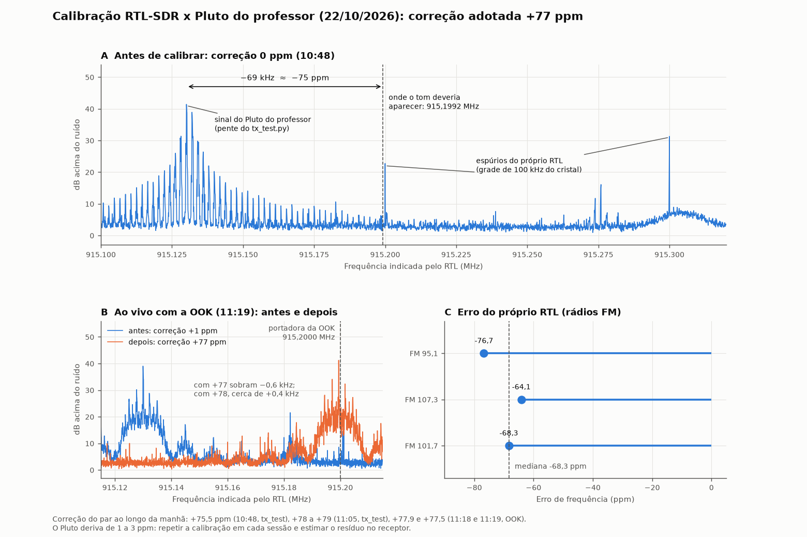

# Registro de calibração do RTL-SDR (Etapa 1), revisão 2

Requisitos: **CAL-01** (correção de ppm calibrada e registrada) e **CAL-02** (offset residual medido).



## 1. Resultado

| Item | Valor |
|---|---|
| **Correção adotada** | **+77 ppm**: decisão da equipe em 22/10/2026, para o par "nosso RTL + Pluto do professor" (`configs/rtl.toml`) |
| Correção do par medida ao longo da manhã | de +75,5 a +78,9 ppm; as duas últimas deram +77,9 e +77,5 |
| Resíduo com +77 ppm | cerca de −0,6 kHz na OOK às 11:19; varia com a deriva do Pluto |
| Erro absoluto do nosso RTL (rádios FM) | de −64 a −77 ppm, mediana −68,3 ppm |

O erro grande é principalmente do **nosso RTL**, apesar de o dongle ser vendido como "TCXO". O Pluto do professor contribui com os ppm restantes e **deriva de 1 a 3 ppm** ao longo de uma manhã. Por isso a calibração precisa ser repetida em cada sessão (depois dos 10 min de aquecimento), e o receptor ainda vai ter de estimar um resíduo de centenas de Hz, como o enunciado prevê.

## 2. Montagem

| Item | Valor |
|---|---|
| Transmissor | ADALM-Pluto do professor: `tx_test.py` até ~11:06 e `pluto_tx_ook_v2.py` (OOK 10 kbit/s) a partir de ~11:18 |
| Receptor | RTL-SDR RTL2832U + R820T2, Windows 11, driver WinUSB |
| Sintonia | 914,95 MHz (o sinal esperado cai em +250 kHz, longe do pico DC) |
| Taxa / ganho | 2,048 MS/s; 40 dB (40,2 dB aplicados) ou 30 dB, AGC desligado |
| Ferramentas | `scripts/calibrar_rtl.py`, `scripts/verificar_ppm_fm.py`, `scripts/figura_calibracao.py` |

## 3. Onde cada transmissão do professor coloca a portadora

| Programa | Portadora | Por quê |
|---|---|---|
| `tx_test.py` | **LO + 199,219 kHz** = 915,199219 MHz | O buffer cíclico tem 1024 amostras a 2 MS/s e o tom de 200 kHz completa 102,4 ciclos nele. O espectro vira um pente com passo de 1953,125 Hz, e o dente principal é o k = 102 (o k = 103 fica 3,5 dB abaixo). Achado A15. |
| `pluto_tx_ook_v2.py` | **LO + 200,000 kHz** = 915,200000 MHz | Cada bit tem 200 amostras e 20 ciclos inteiros da portadora, para qualquer mensagem. |

Usar a referência errada desloca o resultado em 0,85 ppm. Por isso o script tem a opção `--tx-test`, que só deve ser usada quando o professor roda o `tx_test.py`.

## 4. Linha do tempo das medições

| Horário | Sinal | Correção durante a captura | Correção total do par | Situação |
|---|---|---|---|---|
| 10:48 | `tx_test.py` | 0 | **+75,5 ppm** | reprocessado (`calibracao_20261022_111529.json`) |
| 10:48 | | 0 | ~~0 ppm~~ | **inválido**: travou num espúrio do RTL (ver seção 5) |
| ~11:05 | `tx_test.py` | 0, 1 e 77 | +78,7 / +78,8 / +78,9 ppm | medições de diagnóstico (só impressas) |
| ~11:06 | `tx_test.py` | 0, quatro sintonias | +77,9 ppm (média) | medição de diagnóstico; confirmou que o sinal é real |
| 11:18 | OOK | +1 | **+77,9 ppm** | reprocessado com a referência da OOK (`..._112118.json`) |
| 11:19 | OOK | +1, depois +77 | **+77,5 ppm**; resíduo com +77 de cerca de −0,6 kHz | reprocessado (`..._112123.json`); figura, painel B |

## 5. O que deu errado no caminho, e como foi corrigido

Ficam registrados, porque fazem parte da análise de falhas pedida no projeto.

1. **"Calibração de 0 ppm" (10:48).** A busca estreita, de ±10 kHz em volta de 915,2 MHz, travou numa raia que é **espúrio do próprio RTL**. Ele gera uma família de raias em múltiplos exatos de **100 kHz** (o cristal de 28,8 MHz dividido por 288) e de **256 kHz** (a taxa de amostragem dividida por 8). Como saem do próprio relógio do dongle, aparecem em números "redondos" mesmo com o RTL errando −68 ppm. **Correção:** o script descarta automaticamente raias nessa grade (`possivel_espurio_rtl`) e busca em ±150 kHz.
2. **Dente errado do pente do `tx_test.py`.** Uma estimativa intermediária usou o dente k = 101 no lugar do k = 102. **Correção:** a detecção usa o espectro médio, e os dentes vizinhos do mesmo pente não contam como sinais concorrentes (`mesmo_pente`).
3. **Referência errada quando o professor trocou para a OOK.** As rodadas ao vivo das 11:18 e 11:19 usaram `--tx-test` com o sinal já em OOK. Elas foram reprocessadas com a referência certa, e os registros originais foram mantidos com uma nota.
4. **Captura de "Pluto desligado" contaminada.** O professor voltou a transmitir durante a captura de fundo das 11:16. Ela foi descartada e não é usada como evidência.

## 6. Por que o `rx_test_915.py` deu 77 e como usar o 77

- O script do professor procura o maior pico da banda inteira com FFT de 500 Hz por bin (achado A6). Neste RTL isso funciona só quando o sinal do Pluto é o mais forte da banda.
- Ele descarta a correção inicial (achado A5). Partindo de 1 ppm, ele mediu 77 e aplicou 77. Pela própria medição dele, o total seria 78. A diferença entre 77 e 78 fica dentro da deriva do Pluto, e a equipe adotou **77**.
- **Atenção:** colocar `freq_correction = 77` no início do `rx_test_915.py` **não** mantém os 77. O script mede o que sobra (perto de 0), aplica só isso e descarta os 77. A correção deve ser fixada no **receptor**: `FREQ_CORRECTION_PPM = 77` no `rtl_rx_ook_v2.py` (Bloco 2) e `configs/rtl.toml` no nosso código.

## 7. Impacto nas próximas etapas

- **OOK:** o resíduo de centenas de Hz não afeta (filtro de ±10 kHz, detecção de envoltória).
- **BPSK coerente:** com −0,6 kHz de resíduo, a fase gira 21,6° por símbolo a 10 kbaud e cerca de 2,2° a 100 kbaud. Num pacote de 1109 símbolos isso dá várias voltas. Então a BPSK precisa de DBPSK ou de estimar o resíduo pelo preâmbulo (decisão D2). A deriva do Pluto, de centenas de Hz por minuto, reforça essa necessidade.
- **Faixa ISM:** há outros sinais na banda, e o nosso RTL tem espúrios próprios em 915,0, 915,2 e 915,3 MHz. A escolha do deslocamento do nosso sinal deve evitar essas frequências.

## 8. Como reproduzir

Com o RTL ligado há pelo menos 10 min:

```powershell
# professor rodando o tx_test.py
.venv\Scripts\python scripts\calibrar_rtl.py --freq-tom-hz 915.2e6 --tx-test --correcao-inicial-ppm 1 --salvar-iq
# professor rodando a OOK (pluto_tx_ook_v2.py)
.venv\Scripts\python scripts\calibrar_rtl.py --freq-tom-hz 915.2e6 --correcao-inicial-ppm 1 --salvar-iq
# erro absoluto do RTL, sem depender do Pluto
.venv\Scripts\python scripts\verificar_ppm_fm.py
# figura-resumo a partir dos arquivos gravados
.venv\Scripts\python scripts\figura_calibracao.py
```

## 9. Evidências (`dados/calibracao/`)

| Arquivo | Conteúdo |
|---|---|
| `calibracao_20261022_104830.*` | captura das 10:48 (`tx_test.py`); o JSON original está marcado como inválido |
| `calibracao_20261022_111529.json/.png` | reprocessamento das 10:48: +75,5 ppm |
| `calibracao_20261022_111837.*`, `..._111918.*` | rodadas ao vivo (OOK), com nota de referência incorreta |
| `calibracao_20261022_112118.json`, `..._112123.json` | reprocessamentos com a referência da OOK: +77,9 e +77,5 ppm |
| `fm_20261022_111611.json` | erro absoluto do RTL pelas emissoras FM |

As capturas IQ (`.npy`) ficam só no disco, fora do git.
