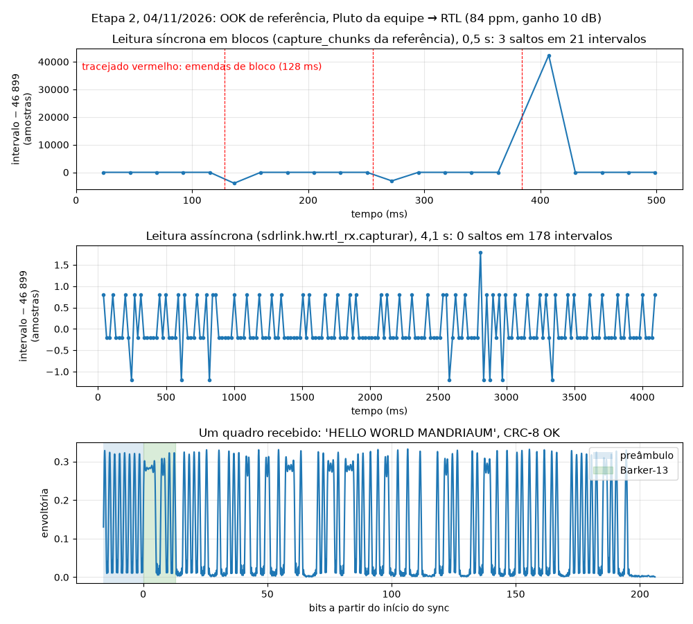
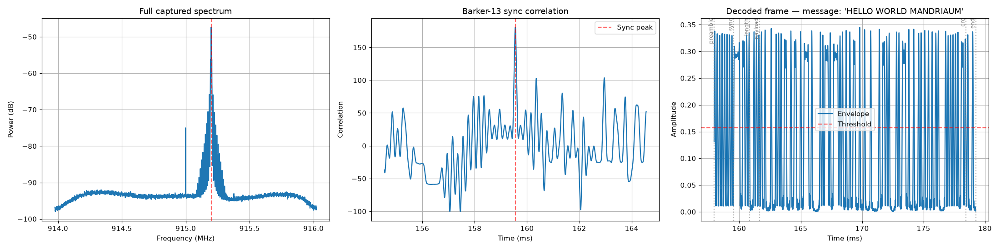
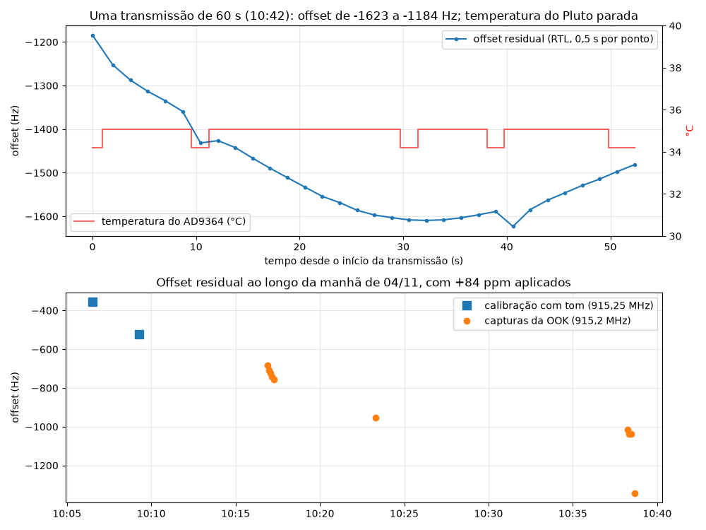

# Etapa 2: recepção da OOK de referência no enlace real

Requisitos: **MOD-01** (OOK no enlace real), **RX-02** (captura gravada), **CAL-01/CAL-02** (correção aplicada e offset residual medido). Achados novos: **A17**, **A18** e **A19**.



## 1. Resultado

| Item | Valor | Evidência |
|---|---|---|
| Mensagem recebida | `HELLO WORLD MANDRIAUM` (21 bytes), CRC-8 OK | logs abaixo |
| Receptor da referência, sem alteração de lógica | **8 de 8** recepções com CRC OK (5 às 10:16 e 3 às 10:38) | `dados/logs/etapa2_rx_*.log`, seção 3 |
| Todos os quadros das 5 capturas da referência (leitura síncrona, 0,5 s cada) | 95 com CRC OK, **12 com CRC falho**, 2 não detectados | seção 5 |
| Todos os quadros da captura contínua de 16 s (leitura assíncrona) | **698 de 698 com CRC OK** | seção 4 |
| PER medida na captura de 16 s | **0 / 698 = 0%** (limite da prova: 1%) | seção 4 |
| BER do payload na captura de 16 s | **0 / 117 264 bits** | seção 4 |
| Offset residual da portadora | de **−0,68 a −1,62 kHz** ao longo da manhã, com +84 ppm aplicados | seção 6 |
| Ganho do RTL | pedido 10 dB, **aplicado 8,7 dB** (degrau do R820T), AGC desligado | `Captura.ganho_db` |
| Correção de frequência | +84 ppm ([calibração de 04/11](calibracao_rtl.md)) | |

A OOK de referência funciona no enlace real. As falhas de CRC que apareceram não vêm do canal: vêm da forma como a referência lê o RTL, que perde amostras a cada 128 ms (achado A17, seção 5). Com a leitura assíncrona do nosso pacote nenhuma amostra se perde e todos os quadros passam no CRC.

**Sobre PER e BER.** O limite das provas é **PER ≤ 1%** (seções 8 e 12 do enunciado); a BER não tem limite, só precisa ser medida (Etapa 5). Os 1,3% citados na seção 5 são a fração de *amostras* perdida pela leitura da referência, não uma BER. Neste ensaio o quadro é sempre o mesmo e não tem número de sequência, então a PER aqui é contada pelo período fixo do TX; a PER oficial, pelo log do transmissor, só existe a partir do quadro com número de sequência da Etapa 3.

## 2. Montagem

| Item | Valor |
|---|---|
| Transmissor | Pluto da equipe (Rev.C AD9364, fw v0.32, `ip:192.168.2.22`), `pluto_tx_ook_v2.py`, ganho de TX −20 dB (padrão da referência) |
| Sinal | OOK 10 kbit/s, portadora em LO + 200 kHz = 915,200 MHz, quadro repetido em buffer cíclico |
| Receptor | RTL-SDR RTL2832U + R820T2, 915 MHz, 2,048 MS/s, AGC desligado |
| Distância | rádios lado a lado na bancada |
| Computadores | **um só PC** para TX e RX neste ensaio (ver pendência P2 em [auditoria_etapas_1_2.md](auditoria_etapas_1_2.md)) |
| Aquecimento | RTL ligado desde antes da primeira medição FM (09:57), mais de 15 min antes do ensaio |

## 3. O que mudou nas cópias de ensaio e o log da recepção

Os programas do professor ficam intactos em `referencia/`. O ensaio usa cópias geradas por [`ensaios/etapa2/gerar_copias.py`](../ensaios/etapa2/gerar_copias.py), e o diff completo está em [`ensaios/etapa2/diferencas.diff`](../ensaios/etapa2/diferencas.diff).

| Arquivo | Mudança | Motivo |
|---|---|---|
| TX | `while True` trocado por 60 s fixos, com `tx_destroy_buffer` no `finally` | o ensaio roda sem teclado e o Pluto não pode ficar transmitindo |
| RX | `GAIN = 30` para `GAIN = 10` | saturação (seção 4.1) |
| RX | `FREQ_CORRECTION_PPM = 34` para `84` | calibração do par com o Pluto da equipe |
| RX | grava a captura (`.npy`) e a figura (`.png`) em `dados/capturas/` | evidência da recepção |

A demodulação, o sincronismo, o limiar e o CRC da referência não foram tocados.

Log de console de uma recepção (`dados/logs/etapa2_rx_20261104_103811.log`, as outras duas das 10:38 são iguais em forma):

```
Capturing ~0.50 s at 915.000 MHz, gain=10 dB, ppm=84...
  chunk 1/4 captured  chunk 2/4 captured  chunk 3/4 captured  chunk 4/4 captured
Total samples: 1048576 (~512.0 ms)
Sync correlation peak at sample 326763 (t=159.55 ms), strength=180.52
Preamble levels: high=0.2639, low=0.0502, threshold=0.1571
Decoded length byte: 00010101 = 21 bytes
Decoded message: 'HELLO WORLD MANDRIAUM'
CRC-8 received=0x44 computed=0x44 -> OK ✅
```

Figura gerada pelo próprio receptor da referência nessa recepção:



## 4. Captura contínua: PER, BER e saturação

Captura de 16,0 s às 10:38:41 com `sdrlink.hw.rtl_rx.capturar` (leitura assíncrona), processada por [`decodificar_quadros_ensaio.py`](../ensaios/etapa2/decodificar_quadros_ensaio.py), que usa as funções `crc8`, `bits_to_levels` e `read_bits` da própria referência:

```
16.00 s, 698 quadros achados de 698 esperados, 0 saltos de intervalo
{'CRC OK': 698} não detectados: 0
{'HELLO WORLD MANDRIAUM': 698}
PER = 0/698 = 0.00%
BER = 0/117264 bits = 0.00e+00
offset residual da portadora: -1343.0 Hz
```

Política de contagem (seção 7 do enunciado pede que seja declarada): quadros esperados pelo período fixo do TX, do primeiro ao último sincronismo; não detectados e CRC falho contam como falha na PER; o quadro cortado pelo fim da janela de captura não entra (limite da captura, não do enlace). A BER compara o payload decodificado com a mensagem conhecida em todos os quadros detectados com o comprimento certo, inclusive os de CRC falho; os quadros não detectados ficam fora da BER e aparecem na PER.

### 4.1 Saturação com o ganho da referência

Com os rádios lado a lado, o Pluto em −20 dB e o RTL em 30 dB, de 26% a 29% das amostras ficaram no fundo de escala do ADC de 8 bits. A envoltória fica achatada e uma das recepções falhou no CRC. Testei os ganhos com o mesmo sinal:

| Ganho do RTL | Amostras saturadas | Pico da amplitude |
|---|---|---|
| 30 dB | 26% a 29% | fundo de escala |
| 20 dB | 0% | 0,79 do fundo de escala |
| 10 dB (8,7 aplicado) | 0% | 0,32 do fundo de escala |

Adotei 10 dB por margem. O ganho certo depende da distância, por isso `sdrlink.hw.rtl_rx.fracao_saturada` passa a ser conferida em todo ensaio; acima de 0,1% o ganho tem de baixar. A captura de 16 s teve 0% de saturação.

## 5. Achado A17: a leitura em blocos perde amostras

### 5.1 Como apareceu

A referência decodifica só o primeiro quadro de cada captura (A1). Decodificando **todos** os quadros de cada captura, de 2 a 3 por captura falhavam no CRC, sempre nos mesmos pontos no tempo.

O transmissor repete o quadro a cada 229 bits × 204,8 amostras = **46 899,2 amostras**, sem variação. O intervalo medido entre os sincronismos bate com esse valor em quase todo lugar, menos exatamente nas emendas dos blocos de 256 k amostras (128 ms) do `capture_chunks`:

| Captura (04/11) | Amostras perdidas em cada emenda |
|---|---|
| 10:16:54 | 3 948, 3 102, 4 512 (nesta o quadro inteiro sumiu) |
| 10:17:00 | 2 727, 3 008, 3 477 |
| 10:17:05 | 4 324, 5 075, 3 665 |
| 10:17:10 | 2 256, 2 350, 2 632 |
| 10:17:16 | 3 760 (quadro sumiu), 3 008, 2 820 |

São 15 perdas em 15 emendas, de 1,1 a 2,5 ms cada, cerca de 1,3% das amostras. Um quadro que atravessa a emenda fica com um buraco no meio e falha no CRC; se o buraco cai no sincronismo, o quadro nem é detectado. Na prática, com o leitor da referência, a PER ficaria perto de 13% (14 falhas em 109 quadros).

### 5.2 Causa

`read_samples` e `read_bytes` fazem uma transferência USB síncrona por chamada. Entre uma chamada e a próxima (conversão para complexo e cópia no Python), o RTL continua amostrando e o buffer interno transborda. Nossa primeira versão de `capturar` lia do mesmo jeito e perdeu 31 vezes em 4,1 s.

### 5.3 Correção

`sdrlink.hw.rtl_rx.capturar` passou a usar a **leitura assíncrona** da librtlsdr (`read_bytes_async`). A biblioteca mantém 15 buffers USB em fila e chama um callback a cada bloco. O callback (`Acumulador`) só copia o bloco para um vetor pré-alocado e cancela a leitura quando o vetor enche. Um temporizador garante o término mesmo se o rádio parar de responder (regra 2 do padrão de código).

Ao cancelar, a librtlsdr devolve o código do último `libusb_cancel_transfer`, que é `LIBUSB_ERROR_NOT_FOUND` quando a transferência já tinha terminado. O pyrtlsdr transforma isso em exceção e fecha o rádio. Com o vetor cheio esse erro é o fim normal da leitura e é ignorado; com o vetor incompleto vira `RuntimeError`. Os dois casos têm teste automático.

### 5.4 Verificação

| Captura | Leitura | Saltos de intervalo | Desvio máximo do intervalo | CRC OK |
|---|---|---|---|---|
| 5 capturas da referência, 0,5 s | síncrona | 15 | 5 075 amostras | 95 de 109 |
| `capturar`, 4,1 s (10:23) | assíncrona | **0** | **1,8 amostra** | **178 de 178** |
| `capturar`, 16,0 s (10:38) | assíncrona | **0** | | **698 de 698** |

O desvio de ±2 amostras que sobra é só o arredondamento do pico da correlação.

## 6. Achado A18: o offset residual deriva



O enunciado pede medir o offset residual e explicar como lidamos com ele. Medi a posição da raia da portadora da OOK (FFT longa com interpolação, função `offset_residual_hz`) em todas as capturas e num ensaio dedicado ([`deriva_offset_ensaio.py`](../ensaios/etapa2/deriva_offset_ensaio.py)): uma transmissão de 60 s com uma medida de 0,5 s a cada 1,7 s, lendo junto a temperatura do AD9364 pelo sensor interno do Pluto.

| Momento | Offset residual |
|---|---|
| 10:06 e 10:09 (calibração com tom) | −356 e −524 Hz |
| 10:16 a 10:17 (5 capturas) | −685 a −758 Hz |
| 10:23 | −953 Hz |
| 10:38 | −1 015 a −1 343 Hz |
| 10:42, dentro de uma transmissão de 60 s | de −1 184 a −1 623 Hz (registro `dados/logs/deriva_offset_20261104_104204.json`) |

O que isso mostra:

1. **Deriva lenta**: cerca de −1 kHz (1,1 ppm) em 35 minutos, sempre no mesmo sentido; somando a variação rápida, o offset foi de −0,36 a −1,62 kHz.
2. **Variação rápida**: dentro de uma transmissão de 60 s o offset andou 440 Hz, com inclinação de até cerca de −35 Hz/s nos primeiros segundos.
3. **A temperatura do chip do Pluto ficou parada** em 34 a 35 °C (resolução de 1 °C), então ela não explica a variação. Com um par de rádios só não dá para separar a parte do Pluto da parte do RTL; isso fica para um ensaio com as rádios FM medidas no mesmo intervalo (pendência P4 da auditoria).

Como lidamos com ele:

- **OOK**: o detector de envoltória não depende da fase, e o filtro de ±10 kHz da referência tem folga para ±1,6 kHz. Nada a fazer.
- **2-FSK e BPSK (Etapa 3)**: o receptor **não pode supor offset fixo**. Um pacote de 128 bytes dura cerca de 10 ms a 100 kbit/s; nesse tempo a deriva (até cerca de 35 Hz/s) muda o offset em menos de 1 Hz, mas o valor absoluto, de até cerca de 2 kHz, gira a fase da BPSK em 20 voltas a cada 10 ms. Por isso o offset será **estimado em cada pacote** a partir do preâmbulo (ou será usada DBPSK, com a comparação em simulação que o enunciado exige), e a faixa de busca será de pelo menos ±3 kHz.
- **Calibração**: repetir no início de cada sessão de bancada, depois do aquecimento, e registrar o offset junto com cada ensaio.

## 7. Achado A19: erro de I2C ao fechar o RTL depois da leitura assíncrona

Em algumas capturas a librtlsdr imprime, ao fechar o rádio:

```
r82xx_write_arr: i2c wr failed=-6 reg=06 len=1
rtlsdr_demod_write_reg failed with -6
```

| Teste (04/11) | Ocorrências |
|---|---|
| 12 capturas seguidas com `capturar` (assíncrona, pyrtlsdr) | 2 |
| 20 capturas com a chamada direta à librtlsdr, sem o fechamento antecipado do pyrtlsdr | 1 |
| 25 capturas com a chamada direta e pausa de 100 ms antes de fechar | 1 |
| 20 capturas com leitura síncrona | 0 |

O erro acontece na escrita que põe o sintonizador em repouso, **depois** que a captura já terminou. Em todas as ocorrências a captura estava completa (o código confere) e a captura seguinte funcionou: foram mais de 70 aberturas seguidas sem falha. Conclusão: não afeta os dados; fica registrado e sob observação. Se aparecer falha na abertura seguinte, a alternativa é um leitor síncrono em thread separada com fila, que também não perde amostras.

## 8. Linha do tempo

| Horário | O quê | Resultado |
|---|---|---|
| antes de 10:16 | Primeiras recepções com ganho 30 dB (capturas apagadas) | 26% a 29% saturado, uma falha de CRC |
| 10:16 a 10:17 | 5 recepções com a cópia de ensaio (ganho 10 dB, 84 ppm) | 5 de 5 com CRC OK |
| depois | Decodificação de todos os quadros das 5 capturas | 12 falhas, todas nas emendas: achado A17 |
| 10:23 | Captura contínua de 4,1 s com a leitura assíncrona, duas rodadas | 0 saltos, 178 de 178 com CRC OK |
| 10:38 | 3 recepções da referência com log de console | 3 de 3 com CRC OK |
| 10:38 | Captura contínua de 16 s | 698 de 698, PER 0%, BER 0 |
| 10:42 | Ensaio de deriva durante uma transmissão de 60 s | offset de −1,18 a −1,62 kHz: achado A18 |
| 10:45 em diante | Testes do erro de I2C | achado A19 |

## 9. Como reproduzir

```
python ensaios/etapa2/gerar_copias.py
python ensaios/etapa2/pluto_tx_ook_v2_ensaio.py        # PC do TX, 60 s
python ensaios/etapa2/rtl_rx_ook_v2_ensaio.py          # PC do RX, grava em dados/capturas/
python ensaios/etapa2/decodificar_quadros_ensaio.py dados/capturas/<captura>.npy
python ensaios/etapa2/deriva_offset_ensaio.py 54       # com o TX ligado; grava em dados/logs/
python ensaios/etapa2/figura_etapa2_ensaio.py <captura_ref.npy> <captura_continua.npy> docs/figuras/etapa2_04nov.png
python ensaios/etapa2/figura_deriva_ensaio.py dados/logs/deriva_offset_<...>.json docs/figuras/deriva_offset_04nov.png
```

## 10. Evidências

| Evidência | Onde |
|---|---|
| Logs de console do TX e do RX da referência | `dados/logs/etapa2_tx_*.log`, `dados/logs/etapa2_rx_*.log` (no git) |
| Registro do ensaio de deriva | `dados/logs/deriva_offset_20261104_104204.json` (no git) |
| Capturas IQ e figuras da referência | `dados/capturas/ook_ref_20261104_*.{npy,png}` (fora do git pelo tamanho, índice em [dados/README.md](../dados/README.md)) |
| Capturas contínuas (4,1 s e 16 s) | `dados/capturas/ook_ref_continua_20261104.npy`, `dados/capturas/ook_ref_continua16s_20261104_103841.npy` (fora do git) |
| Diferenças das cópias de ensaio | [`ensaios/etapa2/diferencas.diff`](../ensaios/etapa2/diferencas.diff) |
| Figuras | [`etapa2_04nov.png`](figuras/etapa2_04nov.png), [`etapa2_rx_referencia_04nov.png`](figuras/etapa2_rx_referencia_04nov.png), [`deriva_offset_04nov.png`](figuras/deriva_offset_04nov.png) |
| Código da correção do A17 | `sdrlink/hw/rtl_rx.py` e `tests/test_rtl_rx.py` |

## 11. O que isso muda para a Etapa 3

1. **Leitura**: o receptor do projeto usa só `capturar` (assíncrona). Para os 60 s da prova serão 123 M amostras; o vetor de bytes brutos (246 MB) cabe na memória, e a conversão para complexo será feita em pedaços.
2. **Ganho**: começar em 10 dB lado a lado, conferir `fracao_saturada` antes de cada ensaio e registrar o ganho **aplicado**, não o pedido.
3. **Offset**: estimar por pacote, com busca de pelo menos ±3 kHz (A18).
4. **Todos os quadros**: o decodificador desta etapa já tem a estrutura que falta na referência (A1): achar todos os sincronismos e decodificar cada um. É o ponto de partida do RX multiquadro com número de sequência e CRC-16, e da PER oficial pelo log do TX.
