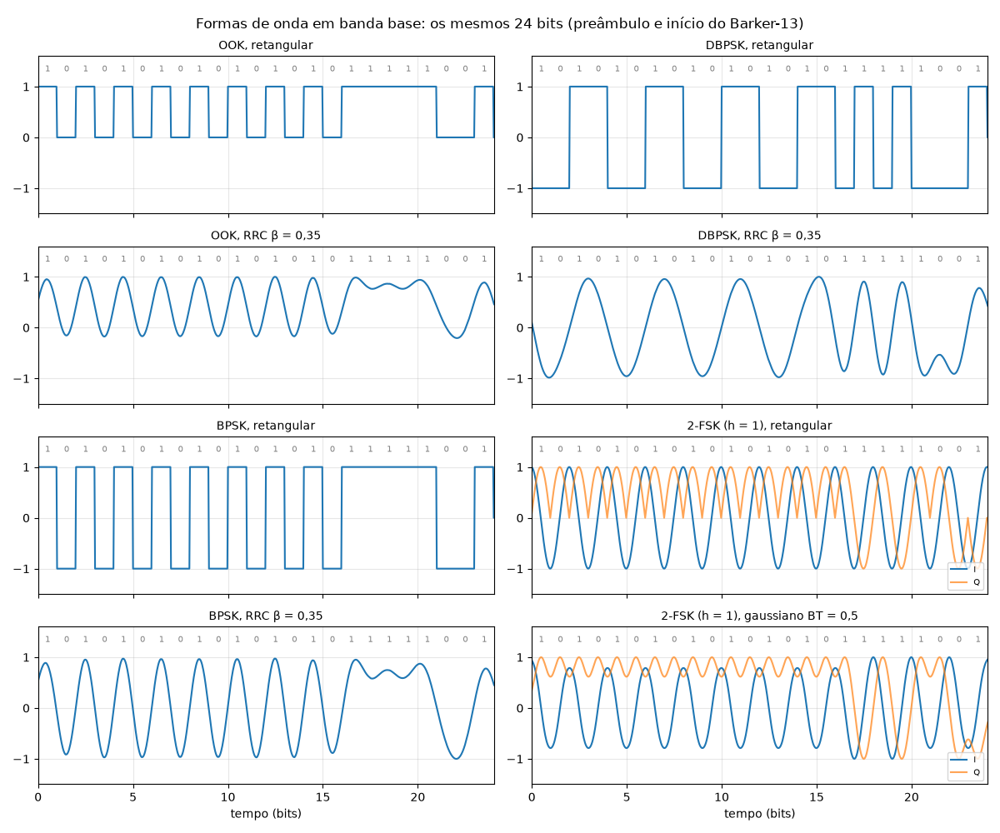
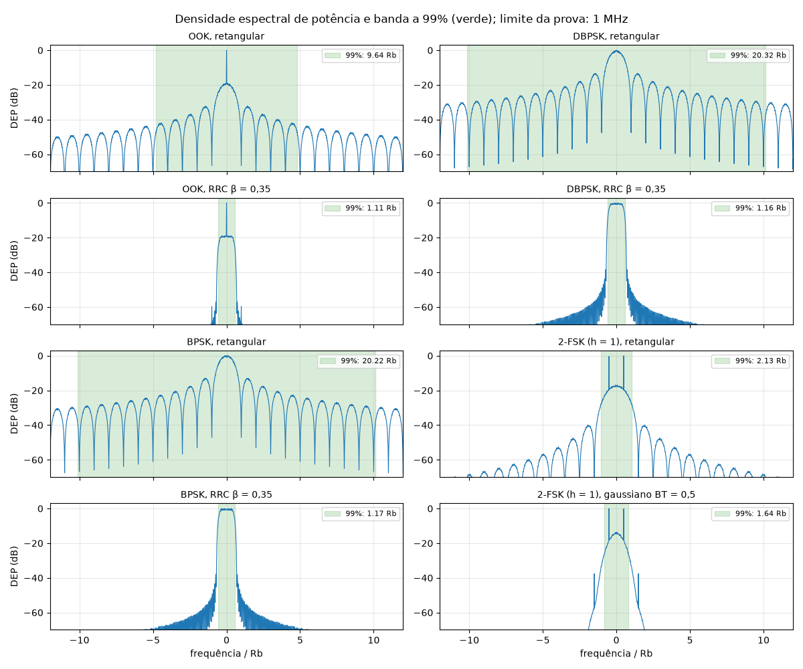
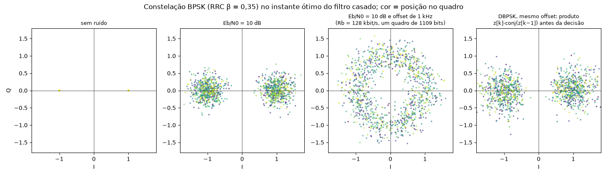

# Etapa 3b: OOK, 2-FSK e BPSK em simulação

Requisitos: **MOD-01 a MOD-03** (OOK, 2-FSK e BPSK implementados pela equipe), **PUL-01** (formatação de pulso além da retangular, justificada pela banda), **MET-04** (banda a 99%). Entrega da Etapa 3 pedida no enunciado: "gráficos de formas de onda, espectros (com banda de 99% calculada) e constelação BPSK".

Código:
- [`sdrlink/pulsos.py`](../sdrlink/pulsos.py): pulsos;
- [`sdrlink/modem.py`](../sdrlink/modem.py): moduladores e demoduladores;
- [`sdrlink/canal.py`](../sdrlink/canal.py): AWGN;
- [`sdrlink/espectro.py`](../sdrlink/espectro.py): banda a 99%.

Testes: [`tests/test_modem.py`](../tests/test_modem.py). Evidências geradas por [`ensaios/etapa3/modulacoes_ensaio.py`](../ensaios/etapa3/modulacoes_ensaio.py) (semente 20261121).

## 1. Resultado

| Modulação e pulso | Banda a 99% simulada | Teoria | Taxa máxima para caber em 1 MHz |
|---|---|---|---|
| OOK, retangular (referência) | 9,64 Rb | 10,43 Rb | 104 kbit/s |
| **OOK, RRC β = 0,35** | **1,11 Rb** | 1,117 Rb | **898 kbit/s** |
| BPSK, retangular | 20,2 Rb | 20,57 Rb | 49 kbit/s |
| **BPSK, RRC β = 0,35** | **1,165 Rb** | 1,167 Rb | **859 kbit/s** |
| DBPSK, retangular | 20,3 Rb | 20,57 Rb | 49 kbit/s |
| **DBPSK, RRC β = 0,35** | **1,164 Rb** | 1,167 Rb | **859 kbit/s** |
| 2-FSK h = 1, retangular (CPFSK) | 2,13 Rb | | 470 kbit/s |
| **2-FSK h = 1, gaussiano BT = 0,5 (GFSK)** | **1,64 Rb** | | **610 kbit/s** |

**Escolha de pulso (PUL-01):** **RRC com β = 0,35** para OOK, BPSK e DBPSK, e **pulso gaussiano com BT = 0,5** para a 2-FSK.

- Com pulso retangular, a BPSK espalha a potência por cerca de 20 vezes a taxa de bits, porque o sinc² cai devagar. O limite de 1 MHz então seguraria a taxa em cerca de 49 kbit/s.
- Com RRC, a mesma BPSK ocupa 1,17 vez a taxa e poderia chegar a cerca de 860 kbit/s.
- Isso não é só ganho de banda. Para a prova B (10 kbit/s de goodput mínimo) e para a prova A (a maior taxa possível), o pulso retangular é inviável.

**Simulação contra teoria:**
- Nos pulsos RRC a diferença ficou abaixo de 0,3%.
- Nos retangulares, a estimativa de Welch subestima a banda em 2% a 8%, porque a cauda do sinc² é muito longa e fica perto do piso de vazamento da janela.
- Para a 2-FSK não há fórmula fechada simples. Fica o valor simulado, que será conferido na medição do RTL (Etapa 5).

## 2. Como foi implementado

| Modulação | Símbolos | Detecção | Precisa da fase da portadora? |
|---|---|---|---|
| OOK | amplitudes 0 e 1 | não coerente: módulo do filtro casado e limiar entre os dois níveis | não |
| BPSK | amplitudes −1 e +1 | coerente: sinal da parte real do filtro casado | **sim** |
| DBPSK | bit 1 inverte a fase; um símbolo de referência no início | diferencial: sinal de Re(z[k] · conj(z[k−1])) | não |
| 2-FSK | fase contínua, tons em ±h·Rb/2, h = 1 | não coerente: energia da correlação com cada tom em uma janela de um bit | não |

- Um bit por símbolo em todas as modulações.
- Sinal complexo em banda base, com `sps` amostras por símbolo.
- Os pulsos RRC e retangular têm energia unitária. O RRC do TX junto com o filtro casado do RX forma um cosseno levantado, sem interferência entre símbolos.
- O pulso gaussiano da GFSK é um pulso de frequência com área de um símbolo, então cada bit gira a fase em π·h.

**Sincronismo ideal neste sub-bloco.** Os demoduladores recebem o instante de amostragem já conhecido. Estimar o tempo, a fase e o offset a partir do preâmbulo é o trabalho do 3c. Assim a modulação é validada separada do sincronismo.

**Definições usadas:**
- **Eb/N0:** Eb é a energia média por bit medida no próprio sinal; o ruído complexo tem variância N0 por amostra.
- **Banda a 99%:** faixa entre os pontos em que a potência acumulada chega a 0,5% e a 99,5% do total, sobre a densidade espectral estimada por Welch. É a definição da seção 7 do enunciado, e a mesma função vai medir a captura do RTL na Etapa 5.

## 3. Formas de onda

Os mesmos 24 bits (o preâmbulo `1010...` e o começo do Barker-13) nas oito combinações, com amplitude normalizada só para o gráfico.

- O RRC troca as quinas do pulso retangular por oscilações suaves que passam pelo valor certo no centro de cada bit.
- Na DBPSK, cada bit 1 inverte a fase.
- Na 2-FSK, o bit 1 gira o fasor num sentido e o bit 0 no outro. Com o pulso gaussiano a troca de frequência é suave.

## 4. Espectros e banda a 99%

A faixa verde é a banda que contém 99% da potência.

- **OOK:** metade da potência fica na raia da portadora, no centro. Por isso a banda a 99% da OOK é a metade da BPSK com o mesmo pulso.
- **2-FSK com h = 1:** aparecem as duas raias dos tons em ±Rb/2.

**Sobreamostragem na simulação.** Para medir a banda dos pulsos retangulares usei 256 amostras por símbolo, que enxergam até ±128 Rb. Com 32 amostras por símbolo o espectro só vai até ±16 Rb, e a BPSK retangular dava 15,6 Rb em vez de 20,2, porque os lóbulos laterais ficavam cortados e dobrados.

**Consequência para a medição no RTL (Etapa 5, achado A21).** O RTL a 2,048 MS/s enxerga só ±1,02 MHz, e as bordas ainda são atenuadas pelo filtro anti-aliasing. Uma banda medida no RTL nunca passa de cerca de 2 MHz e é sempre subestimada quando o sinal tem caudas largas. Para os pulsos RRC e gaussiano o problema não existe, desde que a banda esperada fique bem dentro da faixa vista (por exemplo, 1 MHz centrado a 0,5 MHz do LO, longe do DC e das bordas).

## 5. Constelação BPSK e o offset residual

Quatro situações, todas com BPSK e RRC na saída do filtro casado, no instante ótimo, ao longo de um quadro v2 de 1 109 bits. A cor indica a posição no quadro.

1. **Sem ruído:** dois pontos exatos em ±1.
2. **Eb/N0 = 10 dB:** duas nuvens separadas, decisão fácil.
3. **Eb/N0 = 10 dB e offset de 1 kHz** (dentro da faixa de −0,4 a −1,6 kHz medida em 04/11, achado A18) a 128 kbit/s:
   - a constelação gira 2π × 1 000 × 1 109 / 128 000 ≈ 54 rad, cerca de 9 voltas em um quadro, e vira um anel;
   - **a BPSK coerente sem estimar o offset não funciona**.
4. **DBPSK com o mesmo offset:** o produto z[k]·conj(z[k−1]) gira só 2π × 1 000 / 128 000 ≈ 2,8° por bit. Os dois grupos continuam em ±1 e a decisão funciona sem estimar nada. O custo é um ruído maior, porque o produto combina dois símbolos ruidosos.

Daqui sai a decisão que o enunciado pede justificar ("como lida com o offset"). As duas opções vão ser comparadas na Etapa 4, com curvas de BER e com o offset medido:
- **(a) BPSK coerente com estimativa do offset por pacote** a partir do preâmbulo, no 3c;
- **(b) DBPSK**, mais simples e cerca de 1 dB pior em BER.

O enunciado aceita DBPSK desde que essa comparação esteja em simulação.

## 6. Pacotes do quadro v2 pela cadeia completa (simulação)

Para cada combinação foram simulados 200 quadros v2 com payload aleatório de 128 bytes e número de sequência. Cada quadro passou por `montar_quadro`, modulação, AWGN, demodulação e `interpretar`, com sincronismo ideal e 8 amostras por símbolo. Um pacote conta como certo só se o CRC-16 confere **e** o pacote é idêntico ao transmitido.

| Modulação e pulso | Eb/N0 = 8 dB | Eb/N0 = 12 dB |
|---|---|---|
| OOK, retangular | PER 100% | PER 13,0% |
| OOK, RRC | PER 100% | PER 9,5% |
| BPSK, retangular | PER 20,5% | **PER 0%** |
| BPSK, RRC | PER 16,5% | **PER 0%** |
| DBPSK, retangular | PER 50,5% | **PER 0%** |
| DBPSK, RRC | PER 53,0% | **PER 0%** |
| 2-FSK, retangular | PER 100% | PER 17,0% |
| 2-FSK, gaussiano | PER 100% | PER 42,5% |

Conferência com a teoria. Para um quadro de 1 064 bits, a PER esperada é 1 − (1 − BER)¹⁰⁶⁴.

| Caso | BER teórica | PER esperada | PER simulada |
|---|---|---|---|
| BPSK, 8 dB | Q(√(2Eb/N0)) = 1,9 × 10⁻⁴ | 18% | 16,5% e 20,5% |
| 2-FSK não coerente, 12 dB | ½·exp(−Eb/2N0) = 1,9 × 10⁻⁴ | 18% | 17% |
| DBPSK, 8 dB | ½·exp(−Eb/N0) = 9,1 × 10⁻⁴ | 62% (erros independentes) | 51% e 53% |

A DBPSK fica abaixo da conta porque seus erros vêm em pares vizinhos, e um par afeta um só pacote.

Leituras:
- As modulações **coerentes e diferenciais** (BPSK e DBPSK) precisam de cerca de 4 dB a menos de Eb/N0 que as **não coerentes** (OOK e 2-FSK) para a mesma PER. É o resultado clássico, e a Etapa 4 vai traçar as curvas completas.
- A **GFSK** perde em relação à CPFSK com o mesmo receptor, PER de 42,5% contra 17%. O pulso gaussiano espalha cada bit sobre os vizinhos (interferência entre símbolos), e o correlator de uma janela não compensa isso. É o preço da banda menor (1,64 contra 2,13 Rb). A Etapa 4 vai medir essa perda em dB e avaliar um BT maior ou um receptor melhor.

## 7. Achados deste sub-bloco

| # | Achado | O que foi feito |
|:-:|---|---|
| — | O RRC truncado em 8 símbolos deixava até 3,4% de interferência entre símbolos no instante ótimo (encontrado por um teste novo) | Duração padrão passou a 12 símbolos: 0,4% |
| A21 | A banda a 99% medida no RTL é limitada a cerca de ±1 MHz pela taxa de amostragem e atenuada nas bordas pelo filtro anti-aliasing | Medir só sinais de banda estreita (RRC e gaussiano) e posicioná-los longe do DC e das bordas; registrado para a Etapa 5 |
| — | Com pulso retangular, nenhuma modulação passa de cerca de 104 kbit/s em 1 MHz | Pulso retangular descartado para as provas; RRC e gaussiano adotados |

## 8. Testes

São 24 testes em `tests/test_modem.py`. O total do projeto passou a 109.

| Teste | O que garante |
|---|---|
| `test_pulsos_tem_energia_ou_area_unitaria_e_rrc_casado_sem_isi` | normalização dos pulsos e RRC casado sem interferência entre símbolos |
| `test_ida_e_volta_sem_ruido` (8 combinações) | modular e demodular devolve os mesmos bits |
| `test_quadro_v2_passa_pela_cadeia_com_ruido` (8 combinações) | quadro v2 com 128 bytes passa pela cadeia com ruído e o CRC confere |
| `test_ber_da_bpsk_coerente_bate_com_a_teoria` | 200 000 bits a 6 dB: BER dentro de 15% de Q(√(2Eb/N0)) |
| `test_bpsk_coerente_precisa_da_fase_e_dbpsk_nao` | com 90° de erro de fase a BPSK falha e a DBPSK não |
| `test_ook_independe_da_amplitude_e_da_fase` | limiar da OOK se adapta ao nível do sinal |
| `test_banda_99_do_rrc_e_da_bpsk_retangular` | banda a 99% contra os valores teóricos |
| `test_filtro_casado_amostra_no_pico_do_simbolo` | instante de amostragem exato (amplitude ±1 no pico) |
| `test_validacoes` | parâmetros inválidos são recusados |

Testes de mutante feitos à mão:

| Mutante | Testes que falham |
|---|---|
| Regra diferencial da DBPSK invertida | 5 |
| Tom da 2-FSK com o sinal trocado | 4 |
| Instante de amostragem atrasado em uma amostra | 3 |

O mutante do atraso só derrubava 1 teste até a entrada do `test_filtro_casado_amostra_no_pico_do_simbolo`. Foi esse teste novo que revelou a interferência do RRC truncado em 8 símbolos.

## 9. Evidências

| Evidência | Onde |
|---|---|
| Figuras | `docs/figuras/etapa3_formas_de_onda.png`, `etapa3_espectros.png`, `etapa3_constelacao_bpsk.png` |
| Bandas e PER simulada | `dados/logs/modulacoes_20261121_203042.json` |
| Código e testes | `sdrlink/pulsos.py`, `modem.py`, `canal.py`, `espectro.py`, `tests/test_modem.py` |

## 10. Próximo passo (3c)

O receptor real vai precisar de quatro coisas:

1. Achar todos os quadros numa captura, pelo Barker-13 com limiar de detecção (A1 e A2).
2. Estimar o instante de amostragem.
3. Estimar o offset e a fase em cada pacote pelo preâmbulo, por causa do A18 e da BPSK coerente.
4. Entregar os bits a `quadro.interpretar`.

Tudo isso pode ser testado com sinais simulados com offset, atraso e ruído, e com a captura real da OOK de 16 s, sem hardware.
