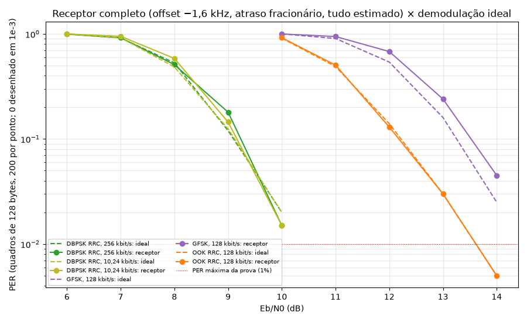

# Etapa 3c: receptor multiquadro

Requisitos:
- **RX-01:** detecção com limiar e todos os quadros da captura;
- **RX-03:** arquivo de saída com sequência e payload;
- **MET-01:** base da PER.

Achados tratados:
- **A1:** a referência decodifica um quadro só por captura;
- **A2:** sem limiar, o maior pico de ruído vira "quadro";
- **A18:** offset residual de até 1,6 kHz.

Código: [`sdrlink/receptor.py`](../sdrlink/receptor.py). Ferramenta de linha de comando: [`scripts/receber.py`](../scripts/receber.py). Testes: [`tests/test_receptor.py`](../tests/test_receptor.py).

## 1. Resultado

| Ensaio | Resultado |
|---|---|
| **Captura real** de 16 s da OOK de referência (04/11, Pluto da equipe → RTL) | **698 de 698** quadros com CRC OK, 0 detecções falsas; offset −1 335 Hz (a FFT longa de 04/11 mediu −1 343 Hz) |
| Capturas simuladas: 20 quadros de 128 bytes, offset de −1,6 kHz, atraso fracionário, 14 dB, blocos pequenos para forçar quadros nas emendas | **20 de 20** em OOK, DBPSK (256 e 10,24 kbit/s), GFSK e CPFSK; nenhum pacote errado aceito |
| Perda de implementação: receptor completo, com tudo estimado, contra a demodulação ideal | **0 a 0,3 dB** (seção 5) |
| Pacotes errados aceitos, em todos os ensaios | **0** |
| Tempo de processamento | **1,16 s por segundo de captura** no pior caso (10 kbit/s): a prova de 60 s leva cerca de 70 s, e o limite é de 10 min |
| `scripts/receber.py` com uma captura simulada de 50 pacotes | arquivo de saída **idêntico ao log do TX**, nos 50 pacotes e na ordem |

**A BPSK coerente não funciona com o offset medido**, e era esperado. A estimativa do offset pelo preâmbulo erra dezenas de hertz, e a Etapa 4 mostrou que a BPSK coerente tolera menos de 10 Hz nessa taxa. Mesmo sem offset, ela acertou 5 de 20 quadros a 10 dB. Isso confirma a decisão da Etapa 4: **a BPSK do projeto é a DBPSK**.

## 2. Como o receptor funciona

Para cada bloco da captura:

1. **Banda base:** multiplica pela exponencial do deslocamento (o TX transmite em LO + deslocamento).
2. **Filtro de canal e decimação** até cerca de 8 amostras por bit (`resample_poly`). A 10 kbit/s isso é decimar por 25.
3. **Filtro de detecção:** um passa-baixas com a meia banda do pulso (0,75 Rb para o RRC, 1 Rb para o gaussiano, 1,25 Rb para a CPFSK).
4. **Correlação** com os 29 bits conhecidos do início de todo quadro (preâmbulo e Barker-13), modulados e passados pela mesma cadeia. O cálculo é coerente sobre o prefixo inteiro, numa grade de hipóteses de offset com passo de 1/(2T), que cobre ±3 kHz com perda máxima de 0,9 dB. A métrica é uma correlação de Pearson complexa e fica entre 0 e 1.
5. **Limiar de 0,5** e **supressão de não-máximos:** um pico por quadro, com no mínimo 60 bits entre picos.
6. **Por quadro:**
   - instante refinado por interpolação parabólica e atraso fracionário;
   - offset = hipótese vencedora + resíduo medido pela rotação de fase entre 4 trechos do prefixo, depois corrigido;
   - na OOK, limiar tirado dos 29 bits conhecidos do prefixo;
   - demodulação (`sdrlink.modem`) e interpretação (`sdrlink.quadro`, CRC-16).

A captura é processada em **blocos de 4 M amostras com sobreposição de um quadro máximo**. Um quadro achado nos dois blocos da emenda vira uma detecção só. A saída é a lista de pacotes com CRC válido, sem duplicatas, na ordem de chegada.

**Restrição:** a taxa de amostragem dividida pela taxa de bits tem de ser inteira. A 2,048 MS/s isso vale para 256, 128, 64 kbit/s e assim por diante. O `scripts/receber.py` recusa outras combinações.

## 3. Decisões, e o que deu errado no caminho

Cada decisão abaixo veio de um teste que falhou ou de uma medição.

| # | Tentativa | O que aconteceu | Decisão |
|:-:|---|---|---|
| 1 | Correlação segmentada não coerente: trechos curtos, cada um girando no máximo 90° no offset máximo | 10 kbit/s: **nenhum** quadro detectado. A 2,048 MS/s o sinal ocupa cerca de 20 kHz, mas o ruído de 2 MHz entra na normalização | **Filtro de canal e decimação** antes de detectar |
| 2 | Média de cada trecho removida (a OOK tem níveis 0 e 1 e correlacionava com qualquer dado: 16 detecções falsas em 20 quadros) | Trechos menores que um bit ficam quase constantes, e remover a média apagava o modelo. Trechos curtos também discriminam mal: **95 detecções falsas** na CPFSK | Correlação **coerente do prefixo inteiro** numa **grade de offsets**, com a média removida sobre a janela toda |
| 3 | Métrica com a energia do sinal sem filtro | A métrica dos quadros reais caía perto do limiar, e na CPFSK apareciam falsos entre 0,45 e 0,47 | **Filtro de detecção** na banda do pulso: zero falsos longe dos quadros no mesmo teste |
| 4 | Modelo gerado direto na taxa decimada | Erro sistemático no instante: +3,2 amostras na CPFSK e −1,2 na GFSK (até 0,1 T) | Modelo **gerado na taxa da captura e decimado pelo mesmo filtro** que o sinal. Junto, a fase da 2-FSK passou a ser a integral até n (soma exclusiva): a soma inclusiva adiantava a fase em uma amostra e o alinhamento dependia da taxa. Erro depois: −0,2 e +0,2 amostra |
| 5 | Limiar da OOK por k-médias na janela de leitura | A janela vai até o maior quadro possível (255 bytes). O silêncio e o quadro seguinte deslocavam o limiar e trocavam bits (1 quadro em 20 perdido) | **Limiar dos 29 bits conhecidos do prefixo**, que não depende do que vem depois. Teste: uma portadora 4 vezes mais forte logo depois do quadro |
| 6 | Uma segunda passada da OOK, com k-médias só nos símbolos do quadro | Em 1 500 quadros a 11 e 12 dB, comparados no mesmo ruído: 46 contra 33 quadros recuperados só por um dos métodos (p ≈ 0,18), **sem ganho significativo**. Um ganho de +14 medido antes, com 300 quadros, foi acaso | **Removida.** Código sem ganho medido não fica |
| 7 | Mesmo quadro na emenda de dois blocos | Lido duas vezes, com inícios dos dois lados da fronteira (21 detecções para 20 quadros) | **Supressão de não-máximos também entre blocos** |

### Escolha do limiar (medida)

Métrica nos quadros reais (mínimo) e fora deles (quantil 99,99% e máximo), com offset de −1,6 kHz. Registro: `dados/logs/receptor_desempenho_20261121_215254.json`.

| Configuração | 6 dB, real mín. | 8 dB, real mín. | 10 dB, real mín. | Falso, 99,99% | Falso, máximo |
|---|---|---|---|---|---|
| DBPSK RRC, 256 kbit/s | 0,58 | 0,69 | 0,75 | 0,36 a 0,39 | 0,50 |
| DBPSK RRC, 10,24 kbit/s | 0,61 | 0,70 | 0,82 | 0,38 a 0,41 | 0,47 |
| GFSK, 128 kbit/s | 0,48 | 0,62 | 0,70 | 0,34 a 0,36 | 0,44 |
| OOK RRC, 128 kbit/s | 0,43 | 0,59 | 0,63 | 0,31 a 0,34 | 0,47 |

Os dois erros não custam o mesmo:
- uma **detecção falsa** custa uma leitura de CRC e **nunca vira pacote errado**;
- uma **detecção perdida** custa um pacote na PER.

Por isso o limiar fica no ponto mais baixo que o falso alarme permite: **0,5**.
- Com ele, todo quadro real é detectado a partir de 8 dB, onde as modulações não coerentes ainda nem decodificam bem.
- A DBPSK é detectada até a 6 dB.
- Falsos raros acima de 0,5 aparecem, sobretudo na CPFSK (15 em uma captura de 20 quadros a 14 dB), e o CRC rejeita todos.

## 4. Validação com a captura real

[`ensaios/etapa3/receptor_captura_real_ensaio.py`](../ensaios/etapa3/receptor_captura_real_ensaio.py) roda o receptor sobre a captura de 16 s de 04/11 (`dados/capturas/ook_ref_continua16s_20261104_103841.npy`).

**Preparação:**
- O TX do professor usa 200 amostras por bit a 2 MS/s, então a captura a 2,048 MS/s é reamostrada por 125/128.
- O quadro da referência não tem número de sequência (comprimento, payload e CRC-8). O receptor recebe um interpretador desse formato.
- A detecção, a estimativa de offset e de instante e a demodulação são as do projeto.

| Item | Decodificador de 04/11 (A17) | Receptor do projeto |
|---|---|---|
| Quadros com CRC OK | 698 / 698 | **698 / 698** (payload `HELLO WORLD MANDRIAUM` nos 698) |
| Quadros esperados pelo período do TX | 698 | 698 |
| Detecções falsas | | 0 |
| Offset | −1 343 Hz (FFT de 16 s) | −1 335 Hz (mediana; 5% a 95%: −1 482 a −1 119 Hz, a deriva do A18) |
| Menor métrica de correlação | | 0,627 |
| Maior desvio do período entre quadros | 0,7 amostra | 0,7 amostra |
| Tempo | | 18,6 s para 16 s de captura (1,16 s por segundo) |

Registro: `dados/logs/receptor_captura_real_20261121_213841.json`.

## 5. Perda de implementação



Para cada configuração e cada Eb/N0, os mesmos 200 quadros de 128 bytes foram simulados de duas formas:
- **ideal:** instante exato, sem offset;
- **receptor completo:** captura contínua com offset de −1,6 kHz, atraso fracionário de 0,37 amostra e tudo estimado pelo preâmbulo.

O Eb/N0 é medido só sobre o sinal dos quadros, sem os intervalos de silêncio.

| Configuração | Perda a PER 50% | Perda a PER 10% | Eb/N0 para PER ≈ 1% (receptor) | Pacotes errados aceitos |
|---|---|---|---|---|
| DBPSK RRC, 256 kbit/s | 0,0 dB | 0,1 dB | cerca de 10 dB (1,5% em 10 dB) | 0 |
| DBPSK RRC, 10,24 kbit/s | 0,2 dB | 0,0 dB | cerca de 10 dB (1,5% em 10 dB) | 0 |
| GFSK, 128 kbit/s | 0,2 dB | 0,3 dB | cerca de 14 dB (4,5% em 14 dB) | 0 |
| OOK RRC, 128 kbit/s | 0,0 dB | 0,0 dB | cerca de 13,6 dB | 0 |

Com 200 quadros por ponto, diferenças de até cerca de 0,1 dB estão dentro da flutuação estatística.
- A **GFSK** é a única com perda clara, de 0,2 a 0,3 dB. O correlator de uma janela da GFSK já perde com interferência entre símbolos (Etapa 4), e fica mais sensível ao pequeno erro que resta no instante e no offset.
- A **DBPSK** chega à PER de 1% da prova perto de 10 dB, cerca de 4 dB antes da OOK e da GFSK.

## 6. Ferramenta para a prova

```
python scripts/receber.py dados/capturas/<captura>.npy --modulacao dbpsk --pulso rrc --taxa-bits 256e3 --deslocamento-hz 250e3
```

Gera dois arquivos ao lado da captura:

- `<captura>_saida.txt`: o **arquivo de saída da prova**, com uma linha por pacote aceito: `sequência<TAB>payload em hexadecimal`, na ordem de chegada e sem repetições. O formato exato pedido pelo avaliador ainda não foi divulgado; se for outro, muda só a função `gravar_saida`.
- `<captura>_rx.json`: o que a seção 7 do enunciado pede registrar:
  - versão do código e parâmetros;
  - duração;
  - detecções, CRC OK, CRC falho, cortados, aceitos e repetições;
  - offset residual (mediana e faixa de 5% a 95%);
  - menor métrica e tempo de processamento.

A captura de 60 s (1 GB) é lida por mapeamento de memória, bloco a bloco.

## 7. Testes

Total do projeto: 130 testes. São 13 em `tests/test_receptor.py`:

| Teste | O que garante |
|---|---|
| `test_todos_os_quadros_com_offset_atraso_e_emendas` (DBPSK, OOK, GFSK, CPFSK) | 8 quadros com offset de −1,6 kHz, atraso de 0,37 amostra, 14 dB e blocos mínimos: todos os pacotes, em ordem, sem duplicata; instante com erro abaixo de 5% do bit; offset com erro abaixo de 300 Hz; nenhuma detecção falsa (exceto CPFSK) |
| `test_todo_quadro_e_detectado_a_8_db` (OOK, GFSK) | a 8 dB todo sincronismo é achado, mesmo sem decodificar |
| `test_taxa_baixa_com_decimacao_e_offset_grande` | 10,24 kbit/s, decimação 25, offset de 16% da taxa: pacotes certos e offset com erro abaixo de 50 Hz |
| `test_so_ruido_nao_gera_pacote` | só ruído não gera pacote e quase nenhuma detecção |
| `test_ook_le_o_limiar_so_no_proprio_quadro` | portadora 4 vezes mais forte depois do quadro não estraga a leitura |
| `test_repeticao_nas_emendas_e_duplicatas` | um quadro visto em dois blocos conta uma vez; repetição do TX conta uma vez |
| `test_arquivo_de_saida` | formato do arquivo de saída |
| `test_resumo_da_recepcao` | contagens e offset do registro |
| `test_validacoes_e_decimacao` | decimação escolhida, grade de hipóteses, parâmetros inválidos recusados |

Testes de mutante feitos à mão (cada decisão desligada de propósito):

| Mutante | Testes que falham |
|---|---|
| Modelo sem a média removida | 2 |
| Sem o filtro de detecção | 2 |
| Sem juntar as detecções repetidas na emenda | 1 |
| Sem o offset fino (só a hipótese da grade) | 4 |
| Sem refinar o instante (só a amostra inteira) | 3 |
| Sem corrigir o offset antes de demodular | 1 |
| Limiar da OOK por k-médias na janela toda (em vez do prefixo) | 1 |

Os mutantes foram rodados de novo contra a versão final do código, antes de publicar. Dois deles (sem a média e sem o filtro de detecção) sobreviviam aos testes da versão anterior e ganharam testes próprios (nenhuma detecção falsa; detecção a 8 dB).

## 8. Evidências

| Evidência | Onde |
|---|---|
| Captura real: resultado | `dados/logs/receptor_captura_real_20261121_213841.json` |
| Limiar e perda de implementação | `dados/logs/receptor_desempenho_20261121_215254.json`, `dados/logs/receptor_desempenho_execucao.log` |
| Figura | `docs/figuras/etapa3_receptor_per.png` |
| Código e testes | `sdrlink/receptor.py`, `scripts/receber.py`, `tests/test_receptor.py`; ajuste da fase da 2-FSK em `sdrlink/modem.py` |

## 9. Próximo passo (3d)

O transmissor de prova:
- lê o arquivo de payloads de 128 bytes do avaliador;
- numera os pacotes e monta os quadros v2;
- modula na configuração escolhida, com o LO dentro da faixa de 915 a 928 MHz e longe da harmônica de 921,6 MHz do RTL (D5);
- grava o **log do TX** (sequência e payload de cada pacote transmitido), que é a referência da PER oficial.

Dá para testar ponta a ponta sem hardware: TX → canal simulado → `scripts/receber.py` → comparação dos dois logs.
