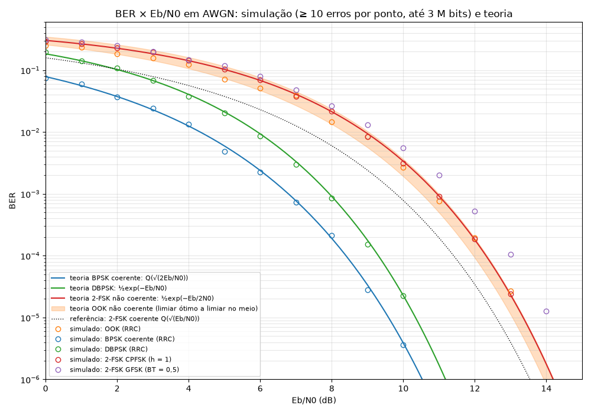
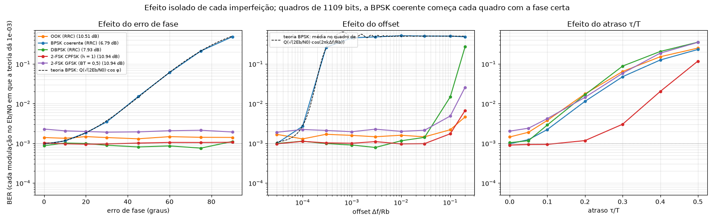
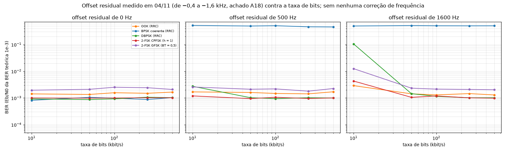

# Etapa 4: simulação do canal

O que o enunciado pede: "Avaliar AWGN, erro de fase, offset de frequência e erro de temporização para as três modulações". Entrega: "Curvas BER × Eb/N0 simuladas comparadas às curvas teóricas, e análise do efeito de um offset residual típico após calibração (centenas de hertz)".

Código:
- [`sdrlink/teoria.py`](../sdrlink/teoria.py): fórmulas de BER;
- [`sdrlink/canal.py`](../sdrlink/canal.py): AWGN, fase, offset e atraso fracionário;
- moduladores e demoduladores do sub-bloco 3b ([etapa3_modulacoes.md](etapa3_modulacoes.md)).

Ensaio: [`ensaios/etapa4/canal_ensaio.py`](../ensaios/etapa4/canal_ensaio.py), semente 20261122, cerca de 10 minutos. O registro completo fica em `dados/logs/etapa4_canal_20261121_210352.json`.

## 1. Conclusões

1. **A simulação bate com a teoria em AWGN.**
   - Diferença de no máximo **0,08 dB** no Eb/N0 necessário para BER de 10⁻³ e 10⁻⁴, na BPSK, na DBPSK e na 2-FSK (seção 3).
   - A OOK cai entre as duas curvas teóricas exatas, como esperado pelo limiar que o demodulador usa.
   - A GFSK perde 0,6 a 0,7 dB, que é o custo da banda menor.
2. **Erro de fase só afeta a BPSK coerente**, e exatamente como Q(√(2Eb/N0)·cos φ): 20° dobram a BER, e 45° a multiplicam por 15. OOK, DBPSK e 2-FSK não sentem a fase.
3. **O offset de frequência é o efeito decisivo.**
   - Mesmo começando cada quadro com a fase certa, a BPSK coerente só aguenta **Δf/Rb < 7,7 × 10⁻⁵** (0,5 dB de perda): isso é **7,7 Hz a 100 kbit/s**.
   - O offset medido em bancada vai de −0,4 a −1,6 kHz (A18), e um preâmbulo de 16 bits não estima a frequência com precisão de poucos hertz.
   - **Sem rastreio de fase, a BPSK coerente não funciona no nosso enlace.**
   - A DBPSK aguenta Δf/Rb até 3 × 10⁻², e a 2-FSK e a OOK até cerca de 10⁻¹.
4. **Com o offset típico, todas as modulações não coerentes funcionam a partir de 50 kbit/s sem nenhuma correção de frequência.**
   - Com 1,6 kHz, a DBPSK perde cerca de 0,25 dB a 50 kbit/s (BER de 1,4 × 10⁻³ em vez de 10⁻³).
   - A 10 kbit/s ela quebra (BER de 0,11), e precisaria de uma correção grosseira de frequência.
5. **O erro de temporização pesa nas modulações com RRC:** o instante de amostragem precisa ficar a menos de **5% do símbolo** para a BER não subir mais de 30%. A 2-FSK de fase contínua é a mais tolerante e aguenta até 20% do símbolo.

**Decisões para o receptor (3c):**

| Decisão | Por quê |
|---|---|
| A BPSK do projeto é implementada como **DBPSK** (aceita pelo enunciado com esta comparação em simulação) | Perde só **1,1 dB** para a BPSK coerente ideal a BER de 10⁻³ (0,85 dB a 10⁻⁴) e dispensa estimar a fase. A BPSK coerente precisaria de rastreio de fase ao longo do quadro, porque nenhuma estimativa pelo preâmbulo chega aos poucos hertz necessários |
| BPSK coerente com rastreio de fase por decisão realimentada fica como **otimização da Etapa 6** | O ganho máximo é cerca de 1 dB, que só vale o esforço se o alcance (prova B) pedir |
| **Correção grosseira de frequência** pelo preâmbulo só abaixo de 50 kbit/s | Acima disso o offset medido já fica abaixo de 3% da taxa de bits |
| Estimativa do instante de amostragem com erro de no máximo **5% do símbolo** | Com 8 amostras por símbolo, escolher a melhor amostra já garante 6,25%, e interpolar entre amostras leva abaixo de 5% |

## 2. Como a simulação foi feita

- **Quadros de 1 109 bits**, o tamanho do quadro v2 com 128 bytes. Cada quadro é modulado, sofre o efeito de canal, recebe ruído e é demodulado. Assim o offset gira a fase ao longo do quadro, como no enlace real, e a BPSK coerente começa cada quadro com a fase certa: é o **melhor caso** de uma estimativa de fase pelo preâmbulo.
- **8 amostras por símbolo.** Sincronismo ideal: o demodulador conhece o instante de amostragem, exceto na varredura de atraso.
- **Eb/N0** é a energia média por bit medida no sinal sobre a densidade do ruído. Pulsos de energia unitária, como em `sdrlink.canal`, que reproduzem as fórmulas clássicas.
- **Monte Carlo:** cada ponto roda até 200 erros ou 3 milhões de bits. No gráfico só aparecem pontos com pelo menos 10 erros.
- **Partes B e C:** cada modulação fica no Eb/N0 em que a teoria dá BER de 10⁻³, para que a perda causada por cada efeito seja comparável entre as modulações.

## 3. BER × Eb/N0 em AWGN, simulação contra teoria

| Modulação | Fórmula teórica | Eb/N0 para BER 10⁻³: teoria / simulação | Eb/N0 para BER 10⁻⁴: teoria / simulação |
|---|---|---|---|
| BPSK coerente (RRC) | Q(√(2Eb/N0)) | 6,79 / **6,73** dB | 8,40 / **8,37** dB |
| DBPSK (RRC) | ½·exp(−Eb/N0) | 7,93 / **7,87** dB | 9,30 / **9,22** dB |
| 2-FSK não coerente, CPFSK h = 1 | ½·exp(−Eb/2N0) | 10,94 / **10,93** dB | 12,31 / **12,31** dB |
| OOK não coerente (RRC) | exata, com a função Q de Marcum: limiar ótimo / limiar no meio | 10,51 a 10,99 / **10,78** dB | 11,96 a 12,34 / **12,33** dB |
| 2-FSK GFSK, BT = 0,5 | (sem fórmula fechada) | 10,94 (CPFSK) / **11,52** dB | 12,31 (CPFSK) / **13,02** dB |

Discrepâncias explicadas:

- **BPSK, DBPSK e CPFSK:** a simulação fica 0,01 a 0,08 dB do lado otimista, dentro da flutuação estatística de 200 erros por ponto (cerca de ±7% na BER, ou ±0,1 dB).
- **OOK:**
  - A fórmula de livro ½·exp(−Eb/2N0) é só uma aproximação para relação sinal-ruído alta.
  - Usei a expressão exata do detector de envoltória. O "0" tem ruído de Rayleigh e o "1" tem distribuição de Rice, com a função Q de Marcum.
  - Ela foi calculada em duas versões: limiar na metade da amplitude e limiar ótimo.
  - O demodulador do projeto acha o limiar pelos próprios dados (k-médias), e a BER simulada fica entre as duas, mais perto do limiar no meio. O teste `test_ber_simulada_da_ook_bate_com_a_formula_exata` confere isso.
- **GFSK:** perde **0,6 dB a 10⁻³ e 0,7 dB a 10⁻⁴** em relação à CPFSK. O pulso gaussiano espalha cada bit sobre os vizinhos, e o correlator de uma janela não compensa essa interferência. Em troca, a banda a 99% cai de 2,13 para 1,64 vezes a taxa de bits, 23% menos.
- **Ordem entre as modulações:** a DBPSK custa 1,1 dB em relação à BPSK coerente, e as não coerentes (OOK e 2-FSK) custam cerca de 4 dB. É o resultado clássico, e a 2-FSK coerente (linha pontilhada, só de referência) fica no meio do caminho.

## 4. Efeito isolado de fase, offset e temporização

BER de cada modulação no Eb/N0 em que a teoria dá 10⁻³ (linha pontilhada), variando um efeito por vez.

### 4.1 Erro de fase fixo

| Erro de fase | 0° | 20° | 30° | 45° | 60° | 90° |
|---|---|---|---|---|---|---|
| BPSK coerente, simulada | 9,6 × 10⁻⁴ | 1,8 × 10⁻³ | 3,5 × 10⁻³ | 1,5 × 10⁻² | 6,0 × 10⁻² | 0,48 |
| BPSK coerente, teoria Q(√(2Eb/N0)·cos φ) | 1,0 × 10⁻³ | 1,8 × 10⁻³ | 3,7 × 10⁻³ | 1,4 × 10⁻² | 6,1 × 10⁻² | 0,50 |
| DBPSK, OOK, 2-FSK | sem efeito (variação dentro da flutuação estatística) | | | | | |

A curva tracejada da figura é a teoria, e os pontos caem sobre ela. As modulações não coerentes e a diferencial não dependem da fase absoluta, como esperado.

### 4.2 Offset de frequência (Δf normalizado pela taxa de bits)

| Modulação | Offset máximo para a BER no máximo dobrar | O que acontece além |
|---|---|---|
| BPSK coerente, fase certa no início do quadro | **cerca de 1 × 10⁻⁴** (teoria: 7,7 × 10⁻⁵ para 0,5 dB) | a fase gira mais de 90° dentro do quadro e a BER vai a 0,5 |
| DBPSK | **3 × 10⁻²** | o giro por bit (2πΔf/Rb) desloca a decisão diferencial: 1,5 × 10⁻² em 0,1 e 0,27 em 0,2 |
| 2-FSK CPFSK | **cerca de 0,1** | o tom sai do centro do correlator: 6,7 × 10⁻³ em 0,2 |
| 2-FSK GFSK | 3 × 10⁻² | 2,6 × 10⁻² em 0,2 |
| OOK | **cerca de 0,1** | o filtro casado perde energia: 4,6 × 10⁻³ em 0,2 |

A teoria da BPSK com offset é a média de Q(√(2Eb/N0)·cos(2πkΔf/Rb)) sobre os 1 109 bits do quadro (curva tracejada). A simulação acompanha:

| Δf/Rb | Teoria | Simulação |
|---|---|---|
| 10⁻⁴ | 2,74 × 10⁻³ | 2,7 × 10⁻³ |
| 3 × 10⁻⁴ | 0,254 | 0,26 |

### 4.3 Erro de temporização (atraso fixo em fração do símbolo)

| Atraso τ/T | 0 | 0,05 | 0,1 | 0,2 | 0,3 |
|---|---|---|---|---|---|
| BPSK coerente | 9,7 × 10⁻⁴ | 1,2 × 10⁻³ | 2,2 × 10⁻³ | 1,1 × 10⁻² | 4,8 × 10⁻² |
| DBPSK | 1,0 × 10⁻³ | 1,2 × 10⁻³ | 2,9 × 10⁻³ | 1,7 × 10⁻² | 8,8 × 10⁻² |
| OOK | 1,4 × 10⁻³ | 1,9 × 10⁻³ | 3,8 × 10⁻³ | 1,8 × 10⁻² | 6,4 × 10⁻² |
| 2-FSK CPFSK | 9,0 × 10⁻⁴ | 9,3 × 10⁻⁴ | 9,4 × 10⁻⁴ | 1,2 × 10⁻³ | 3,0 × 10⁻³ |
| 2-FSK GFSK | 2,0 × 10⁻³ | 2,4 × 10⁻³ | 4,2 × 10⁻³ | 1,4 × 10⁻² | 5,8 × 10⁻² |

Com pulso RRC, amostrar fora do pico perde amplitude e mistura os símbolos vizinhos, então o atraso pesa logo. A 2-FSK de fase contínua só perde a parte da janela que caiu no bit vizinho e é a mais tolerante.

Requisito para o 3c: erro de amostragem de no máximo cerca de **0,05 T** nas modulações com RRC.

## 5. Offset residual típico após a calibração

O enunciado fala em "centenas de hertz". Medimos de −0,4 a −1,6 kHz ao longo de uma manhã (achado A18, [etapa2_recepcao_ook.md](etapa2_recepcao_ook.md)). A tabela usa 500 Hz (típico) e 1,6 kHz (o pior medido) em taxas de bits possíveis para o projeto, **sem nenhuma correção de frequência**. Cada modulação está no Eb/N0 da BER teórica 10⁻³.

| Modulação | 10 kbit/s, 500 Hz | 10 kbit/s, 1,6 kHz | 50 kbit/s, 1,6 kHz | 100 kbit/s, 1,6 kHz | 500 kbit/s, 1,6 kHz |
|---|---|---|---|---|---|
| BPSK coerente | 0,52 | 0,49 | 0,51 | 0,50 | 0,50 |
| **DBPSK** | 2,7 × 10⁻³ | **0,11** | **1,4 × 10⁻³** | 1,1 × 10⁻³ | 1,0 × 10⁻³ |
| 2-FSK CPFSK | 1,2 × 10⁻³ | 4,3 × 10⁻³ | 1,1 × 10⁻³ | 1,2 × 10⁻³ | 1,0 × 10⁻³ |
| 2-FSK GFSK | 2,6 × 10⁻³ | 1,3 × 10⁻² | 2,3 × 10⁻³ | 2,1 × 10⁻³ | 2,0 × 10⁻³ |
| OOK | 1,7 × 10⁻³ | 2,9 × 10⁻³ | 1,4 × 10⁻³ | 1,3 × 10⁻³ | 1,3 × 10⁻³ |

Os valores sem offset ficam todos perto de 1 × 10⁻³ (GFSK cerca de 2 × 10⁻³, OOK cerca de 1,5 × 10⁻³).

Leitura:

- **BPSK coerente sem rastreio de fase: inviável** em qualquer taxa, com qualquer offset medido.
- **DBPSK: funciona a partir de 50 kbit/s** com o pior offset medido. A 10 kbit/s, 1,6 kHz é 16% da taxa de bits e a decisão diferencial quebra. Ali seria preciso corrigir a frequência pelo preâmbulo até cerca de 300 Hz (3% da taxa), o que é fácil.
- **2-FSK e OOK: toleram o offset em todas as taxas**, com perda pequena a 10 kbit/s.
- A deriva durante um quadro (até cerca de 35 Hz/s, A18) é desprezível: um quadro de 1 109 bits a 100 kbit/s dura 11 ms, e o offset muda 0,4 Hz nesse tempo.

**Resposta à pergunta do enunciado "como lida com o offset":** usamos **modulações que não dependem da fase absoluta** (DBPSK, 2-FSK, OOK), em taxas a partir de 50 kbit/s, onde o offset residual medido fica abaixo de 3% da taxa de bits e custa no máximo cerca de 0,25 dB. Abaixo dessa taxa, entra a correção grosseira de frequência pelo preâmbulo.

## 6. Testes

| Teste | O que garante |
|---|---|
| `test_ber_teorica_em_valores_conhecidos` | BPSK 10⁻⁵ em 9,6 dB (valor de tabela), DBPSK e 2-FSK em pontos exatos, BPSK com 90° = 0,5, OOK nos extremos |
| `test_ber_simulada_da_ook_bate_com_a_formula_exata` | 200 000 bits a 10 dB: a OOK simulada fica entre o limiar ótimo e o do meio |
| `test_ber_da_bpsk_coerente_bate_com_a_teoria` | (do 3b) BPSK simulada dentro de 15% de Q(√(2Eb/N0)) |
| `test_girar_e_atrasar` | fase e offset aplicados exatamente; atraso inteiro exato e dois meios atrasos iguais a um atraso de uma amostra |

O total do projeto é de 112 testes.

## 7. Evidências

| Evidência | Onde |
|---|---|
| Resultados completos (todas as BER, número de erros e de bits por ponto) | `dados/logs/etapa4_canal_20261121_210352.json` |
| Saída do ensaio | `dados/logs/etapa4_canal_execucao.log` |
| Figuras | `docs/figuras/etapa4_ber_awgn.png`, `etapa4_imperfeicoes.png`, `etapa4_offset_residual.png` |
| Código e testes | `sdrlink/teoria.py`, `sdrlink/canal.py`, `tests/test_modem.py` |
