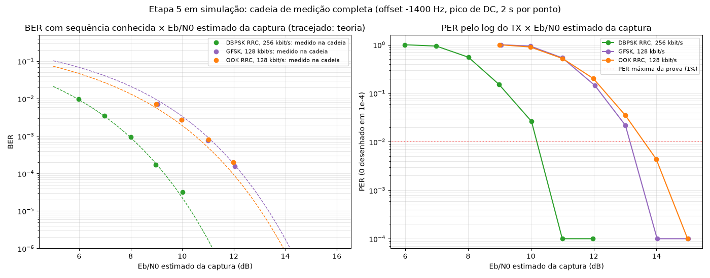

# Etapa 5: caracterização, parte em software

O que o enunciado pede: "Medir goodput, PER, BER (com sequência pseudoaleatória conhecida), banda ocupada a 99% e sensibilidade aos parâmetros". Entrega: "Relatório parcial com gráficos, metodologia e comparação entre simulação e medição".

As medições dependem da bancada. Este documento traz o que fica pronto e validado **antes** dela:
- as ferramentas de medição;
- a prova de que cada uma mede certo, em simulação contra o valor verdadeiro;
- as **curvas de referência simuladas** para a comparação;
- o **protocolo** a seguir na bancada.

Requisitos: **MET-01 a MET-05**.

## 1. O que ficou pronto

| Métrica do enunciado | Como é medida | Onde |
|---|---|---|
| Goodput e PER (MET-01, MET-02) | log do TX × saída do RX, pela seção 7 | `sdrlink.metricas.avaliar`, `scripts/avaliar.py` (sub-bloco 3d) |
| **BER com sequência pseudoaleatória conhecida** (MET-03) | payload de cada pacote gerado pela sequência; comparado em **todo** quadro detectado, inclusive os de CRC falho | `sdrlink.metricas.medir_ber`, `scripts/gerar_payloads.py --conhecidos`, `scripts/receber.py --ber` |
| **Banda ocupada a 99%** pela DEP do RTL (MET-04) | DEP do trecho com sinal menos a DEP de um trecho só de ruído da mesma captura | `sdrlink.medicao`, automático no `scripts/receber.py` |
| **Eb/N0 da captura** (para comparar com a simulação) | potência do sinal sobre N0 medido no ruído, dentro da banda do sinal | `sdrlink.medicao`, automático no `scripts/receber.py` |
| Registro do ensaio (MET-05) | parâmetros, versão do código, contagens, offset, banda, Eb/N0, BER | `<captura>_rx.json` e `tx_<carimbo>.json` |
| Sensibilidade aos parâmetros | varreduras de ganho de TX, taxa e distância na bancada | protocolo da seção 6 |

## 2. Referência simulada para a comparação



[`ensaios/etapa5/referencia_simulada_ensaio.py`](../ensaios/etapa5/referencia_simulada_ensaio.py) passa a **cadeia de medição inteira**, do mesmo jeito que na bancada:
- TX com os payloads conhecidos;
- 0,5 s de ruído antes;
- offset de −1,4 kHz, atraso fracionário, pico de DC e ruído;
- receptor com os bits guardados;
- BER, PER e goodput pelo log do TX;
- banda e Eb/N0 medidos na captura.

Janela de 2 s por ponto. Registro: `dados/logs/etapa5_referencia_20261121_234655.json`.

| Configuração | Eb/N0 | Eb/N0 estimado | Banda a 99% | BER medida | BER teórica | PER | Goodput |
|---|---|---|---|---|---|---|---|
| DBPSK RRC, 256 kbit/s | 6 dB | 5,98 | 295 kHz | 9,8 × 10⁻³ | 9,3 × 10⁻³ | 100% | 0 |
| | 8 dB | 8,01 | 296 kHz | 9,4 × 10⁻⁴ | 9,1 × 10⁻⁴ | 55% | 104 kbit/s |
| | 9 dB | 8,98 | 297 kHz | 1,7 × 10⁻⁴ | 1,8 × 10⁻⁴ | 15% | 198 kbit/s |
| | 10 dB | 10,02 | 295 kHz | 3,2 × 10⁻⁵ | 2,3 × 10⁻⁵ | 2,6% | 228 kbit/s |
| | 11 dB | 11,00 | 297 kHz | 0 em 468 mil bits | 1,7 × 10⁻⁶ | **0%** | **234 kbit/s** |
| GFSK, 128 kbit/s | 9 dB | 9,05 | 219 kHz | 7,3 × 10⁻³ | 9,4 × 10⁻³ | 100% | 0 |
| | 11 dB | 11,00 | 205 kHz | 7,5 × 10⁻⁴ | 9,2 × 10⁻⁴ | 54% | 54 kbit/s |
| | 13 dB | 13,01 | 209 kHz | 2,1 × 10⁻⁵ | 2,3 × 10⁻⁵ | 2,2% | 115 kbit/s |
| | 14 dB | 14,02 | 207 kHz | 0 em 234 mil bits | 1,8 × 10⁻⁶ | **0%** | **117 kbit/s** |
| OOK RRC, 128 kbit/s | 9 dB | 9,00 | 139 kHz | 7,1 × 10⁻³ | 5,6 × 10⁻³ | 100% | 0 |
| | 11 dB | 11,01 | 144 kHz | 8,2 × 10⁻⁴ | 5,0 × 10⁻⁴ | 52% | 56 kbit/s |
| | 13 dB | 13,01 | 142 kHz | 3,0 × 10⁻⁵ | 1,1 × 10⁻⁵ | 3,5% | 113 kbit/s |
| | 15 dB | 14,99 | 142 kHz | 0 em 234 mil bits | 3,0 × 10⁻⁸ | **0%** | **117 kbit/s** |

As teorias usadas são:
- DBPSK: ½exp(−Eb/N0);
- GFSK: a da 2-FSK não coerente, ½exp(−Eb/2N0);
- OOK: a exata com limiar ótimo (Etapa 4).

A tabela completa, com todos os pontos, está no registro.

Leituras:
- **O Eb/N0 estimado da captura acertou o verdadeiro em ±0,05 dB** em todos os 21 pontos. É isso que permite pôr a medição de bancada sobre a curva simulada.
- **A banda medida bate com a da Etapa 3b:** DBPSK 295 a 300 kHz (teoria 298), GFSK 205 a 219 kHz (simulação 210) e OOK 139 a 144 kHz (teoria 143), mesmo com o pico de DC.
- **A BER da DBPSK cai sobre a teoria.** A da OOK fica 1,3 a 2,6 vezes acima da curva do limiar ótimo, porque o receptor tira o limiar dos 29 bits do preâmbulo (cerca de 0,5 dB, Etapa 4). A da GFSK fica até um pouco abaixo da 2-FSK não coerente: com o filtro de banda o receptor observa além de um símbolo (seção 4.2).
- **Para PER de 1% da prova:** cerca de 10,5 dB na DBPSK e cerca de 13,5 dB na GFSK e na OOK. A DBPSK a 256 kbit/s entrega o dobro do goodput com 3 dB a menos.
- **Nenhum pacote errado foi aceito** em nenhum ponto.

## 3. Métodos

### 3.1 BER com sequência conhecida (MET-03)

O enunciado define a BER como "bits de payload incorretos / bits de payload comparados com uma referência conhecida", com "a política de contabilização de quadros perdidos" apresentada à parte.

- **Sequência conhecida.** O payload do pacote de número k é `payload_conhecido(k)`: 128 bytes de um gerador pseudoaleatório (PCG64 do NumPy) com semente fixa e o número do pacote. O TX usa o arquivo de `scripts/gerar_payloads.py --conhecidos N`, e o RX gera o mesmo payload a partir do número.
- **Todos os quadros detectados entram**, inclusive os de CRC falho. O receptor guarda os bits demodulados (`guardar_bits`). Só assim a BER mede o canal: os quadros com CRC OK têm, por definição, zero erro de payload.
- **A sequência de um quadro com CRC falho** pode estar corrompida, e é deduzida em dois passos:
  1. **Segmentos.** Cada detecção entra no segmento cujo último quadro está um número inteiro de períodos antes dela, com tolerância de 2 bits (o TX manda os quadros colados, com período fixo). A referência anda quadro a quadro, então a diferença de relógio entre Pluto e RTL não acumula: alguns ppm dão centenas de amostras em 60 s. Uma detecção que não encaixa abre outro segmento, e segmento de uma detecção só é falso alarme.
  2. **Votação.** Em cada segmento, o campo de sequência lido menos a posição do quadro no segmento tem de dar o mesmo número. Vence o mais votado, com no mínimo 2 votos. Isso não depende de nenhum CRC válido e funciona mesmo com PER de 100%: a 6 dB, os 457 quadros entraram na BER.
- **Política dos quadros perdidos:** quadros não detectados ficam **fora** da BER e aparecem na PER. Cada ensaio registra `quadros_comparados`, `quadros_com_crc_falho_comparados` e `deteccoes_fora_de_posicao`.

### 3.2 Banda ocupada a 99% (MET-04)

Medir direto na captura dá números errados. Os 99% da potência incluiriam o ruído dos 2 MHz inteiros e o pico de DC do RTL, e o resultado mudaria com o ganho.

A medida usa duas densidades espectrais de potência (Welch, 4 096 pontos), **da mesma captura**:
- a do trecho com sinal (até 2 s);
- a do trecho **só de ruído** antes do primeiro quadro, já que o RX começa a gravar antes de o TX começar.

A diferença entre elas é a DEP do sinal. A banda é a faixa entre 0,5% e 99,5% da potência acumulada dessa diferença.

A **diferença não é cortada em zero**. Fora da banda ela flutua em torno de zero, e as flutuações se cancelam na soma. A primeira versão zerava os negativos: sobravam só as flutuações positivas, que, somadas em cerca de 3 700 frequências sem sinal, levaram a banda medida a **1,6 MHz em vez de 298 kHz**.

**Quanto ruído é preciso.** Medido em 5 sementes, com DBPSK a 256 kbit/s:

| Ruído antes do 1º quadro | Erro da banda (máximo) | Erro do Eb/N0 (máximo) |
|---|---|---|
| 49 ms | até 33% (em 8 dB) | até 1,07 dB |
| 122 ms | até 2,7% | até 0,03 dB |
| 244 ms a 977 ms | abaixo de 2% | abaixo de 0,05 dB |

Abaixo de **0,2 s** de ruído a medida é recusada, com o motivo no registro. Na bancada: **começar a gravar pelo menos 1 s antes do TX**.

### 3.3 Eb/N0 da captura

Eb/N0 = P_sinal / (N0 · Rb), onde:
- P_sinal é a integral da DEP líquida (sinal menos ruído);
- N0 é a DEP do ruído **dentro da banda do sinal**, porque o ruído do RTL não é plano: o filtro anti-aliasing atenua as bordas, e há o pico de DC.

É a mesma definição da simulação (`sdrlink.canal`): energia média por bit sobre a densidade do ruído.

## 4. Dois problemas no receptor da 2-FSK, achados aqui

A primeira rodada da referência deu a BER da GFSK cerca de 1 dB pior do que devia. Investigando, apareceram dois problemas independentes.

### 4.1 A22: janela da 2-FSK adiantada

No sub-bloco 3c, a fase da 2-FSK passou a ser a integral da frequência **até n − 1** (soma exclusiva), para o alinhamento não depender da taxa de amostragem. Com isso, cada símbolo aparece na fase uma amostra depois. **A janela do correlator não foi ajustada.**

Deslocando o sinal de propósito, a 11 dB e com 300 mil bits:

| Deslocamento da janela | −1 | 0 (antes) | +1 | +2 |
|---|---|---|---|---|
| GFSK | 2,8 × 10⁻² | 5,0 × 10⁻³ | 1,9 × 10⁻³ | 2,0 × 10⁻³ |
| CPFSK | 1,5 × 10⁻³ | 9,3 × 10⁻⁴ | 9,3 × 10⁻⁴ | 1,5 × 10⁻³ |

A janela da GFSK estava cerca de 1,5 amostra adiantada, com **2,6 vezes mais BER**. Na CPFSK a curva é plana entre 0 e +1, por isso o defeito passou despercebido. Nenhum teste pegava: a ida e volta sem ruído e o quadro a 16 dB têm folga de sobra.

**Correção:** +1 amostra na janela. Com isso a GFSK voltou aos 1,9 × 10⁻³ da Etapa 4.

**Testes de regressão:**
- `test_janela_da_2fsk_esta_no_ponto_otimo`: deslocar uma amostra para qualquer lado não pode melhorar a BER;
- `test_ber_da_gfsk_na_referencia_da_etapa_4`: 2,0 × 10⁻³ em 11 dB.

Os dois falham com o código antigo. As Etapas 3b e 4 foram medidas antes da troca e valem. Os números de GFSK do 3c e do 3d foram **medidos de novo**, e os documentos deles foram corrigidos.

### 4.2 A23: o correlator da 2-FSK aceitava interferência

O correlator da 2-FSK trabalhava sobre a banda decimada inteira (±512 kHz a 128 kbit/s). Já OOK e DBPSK passam pelo filtro casado RRC, que rejeita o que está fora da banda.

Com um pico de DC na captura (o do RTL sempre existe), em 13 dB:

| Pico de DC (em relação à amplitude do sinal) | 0 | 0,3 | 1,0 |
|---|---|---|---|
| DBPSK (8 dB) | 9,0 × 10⁻⁴ | 9,0 × 10⁻⁴ | 9,0 × 10⁻⁴ |
| GFSK antes | 2,5 × 10⁻⁴ | 3,8 × 10⁻⁴ | **6,2 × 10⁻³ (25 vezes)** |
| GFSK depois da correção | 3,4 × 10⁻⁵ | 3,4 × 10⁻⁵ | 3,4 × 10⁻⁵ |

**Correção:** a 2-FSK passou a demodular o sinal **já passado pelo filtro de banda do pulso**, o mesmo da detecção. O pico deixou de ter efeito.

Com 1,2 milhão de bits por ponto, sincronismo ideal e a janela já corrigida, o filtro também baixou a BER **sem** interferência:

| Eb/N0 | GFSK sem filtro | GFSK com filtro | CPFSK sem filtro | CPFSK com filtro | Não coerente (teoria) | Coerente (teoria) |
|---|---|---|---|---|---|---|
| 9 dB | 1,3 × 10⁻² | 5,8 × 10⁻³ | 9,3 × 10⁻³ | 7,0 × 10⁻³ | 9,4 × 10⁻³ | |
| 11 dB | 1,9 × 10⁻³ | 4,8 × 10⁻⁴ | 8,5 × 10⁻⁴ | 5,4 × 10⁻⁴ | 9,2 × 10⁻⁴ | 1,9 × 10⁻⁴ |
| 13 dB | 1,0 × 10⁻⁴ | 1,0 × 10⁻⁵ | 1,4 × 10⁻⁵ | 8,3 × 10⁻⁶ | 2,3 × 10⁻⁵ | |

O resultado com filtro passa da teoria não coerente, ½exp(−Eb/2N0). Isso **não contradiz a teoria**: ela vale para detecção **símbolo a símbolo**. O filtro dura 8 bits e, com a fase contínua da 2-FSK, junta energia dos símbolos vizinhos, o que equivale a um detector com memória. O resultado fica entre a teoria não coerente e a coerente, Q(√(Eb/N0)), que é o intervalo esperado.

A conclusão da Etapa 4 de que "a GFSK perde 0,6 a 0,7 dB para a CPFSK" vale para o correlator de um símbolo. Com o filtro, a GFSK fica **melhor** que a CPFSK sem filtro e ocupa 23% menos banda.

**Teste de regressão:** `test_2fsk_rejeita_um_pico_de_dc_do_tamanho_do_sinal` (receptor completo, GFSK com pico de DC do tamanho do sinal). Falha sem o filtro.

## 5. Validação contra os valores verdadeiros

| Medida | Ensaio | Resultado |
|---|---|---|
| BER | quadros com o payload conhecido, DBPSK 6 a 10 dB, pico de DC | 9,1 × 10⁻³, 7,6 × 10⁻⁴ e 1,7 × 10⁻⁵ contra 9,3 × 10⁻³, 9,1 × 10⁻⁴ e 2,3 × 10⁻⁵ da teoria |
| BER com PER de 100% | DBPSK 6 dB | 457 de 457 quadros comparados, todos com CRC falho; BER 9,8 × 10⁻³ (teoria 9,3 × 10⁻³) |
| Banda a 99% | DBPSK 256 kbit/s, 6, 8 e 10 dB | 296, 296 e 295 kHz contra 298 kHz |
| Eb/N0 | 21 pontos, 3 modulações | erro máximo de 0,05 dB |
| Diferença de relógio | 100 quadros escorregando 0,5 amostra cada (50 no total, 3 vezes a tolerância) | 100 de 100 identificados, num segmento só |
| Campo de sequência corrompido | 4 quadros, o 1º e o último com a sequência errada | a votação acerta; 1 bit de erro de payload, exatamente o colocado |

## 6. Protocolo de medição na bancada

**Preparação:**
1. Ligar o RTL **10 minutos** antes (seção 10 do enunciado). TX e RX em **computadores distintos**.
2. Captura de controle: gravar 2 s no centro escolhido (919,5 MHz) com o Pluto **desligado** e conferir que não há sinal em 919,6 a 919,9 MHz (decisão D5).
3. Calibrar o RTL com o tom (`scripts/calibrar_rtl.py`) e conferir o ppm em `configs/rtl.toml`.

**Arquivos de payload:**

```
python scripts/gerar_payloads.py --conhecidos 20000 dados/capturas/payloads_ber.bin
```

**Cada ponto de medida** (configuração, ganho de TX e distância):
1. RX: gravar **12 s** (`scripts/gravar_iq.py --perfil dbpsk-256k --segundos 12 --pasta dados/capturas/sessao_<data>`), todas as capturas da sessão na mesma pasta, começando pelo menos 1 s antes do TX. Os perfis (`configs/perfis.toml`, bloco 07) garantem os mesmos parâmetros no TX e no RX; para as outras modulações, `gfsk-128k` e `ook-128k`.
2. TX, logo depois de a gravação começar:

   ```
   python scripts/transmitir.py dados/capturas/payloads_ber.bin --perfil dbpsk-256k --duracao-s 10 --ganho-db <G>
   ```

3. RX, processar:

   ```
   python scripts/receber.py <captura>.npy --perfil dbpsk-256k --ber
   ```

   O resultado traz banda a 99%, Eb/N0, BER, saturação, offset e avisos de nível: o `gravar_iq.py` registra o nível eficaz da gravação, e o ganho do RX deve deixá-lo entre −20 e −12 dBFS (janela sem perda de −30 a −6 dBFS, bloco 21).
4. PER e goodput:

   ```
   python scripts/avaliar.py <log_tx>.txt <captura>_saida.txt --duracao-s 10
   ```

5. Anotar o ponto em `dados/README.md`.

**Fim da sessão** (bloco 20, [etapa5_analise_bancada.md](etapa5_analise_bancada.md)):

```
python scripts/analisar_bancada.py dados/capturas/sessao_<data>
```

Junta os registros de todos os pontos numa tabela (ganho do RX, Eb/N0 medido, BER, PER, goodput, banda, offset) e calcula a **perda do enlace**: quantos dB a mais que a teoria cada ponto precisou para a BER medida. Grava `analise_bancada.md` e `analise_bancada.png` (BER e PER × Eb/N0 medido, com a teoria) na pasta da sessão.

**Varreduras (sensibilidade aos parâmetros):**

| Varredura | Valores | Para quê |
|---|---|---|
| Ganho de TX | de −30 dB descendo em passos de 3 dB até a PER passar de 50% | curvas PER, BER e goodput × Eb/N0 **medido**, sobrepostas às da seção 2 |
| Modulação | DBPSK 256 kbit/s, GFSK 128 kbit/s, OOK 128 kbit/s | comparação entre as três (critério de avaliação) |
| Taxa | DBPSK a 64, 128 e 256 kbit/s | goodput × taxa com a mesma potência |
| Distância | lado a lado e o maior ponto disponível na sala | ensaio da prova B |

**Comparação simulação × medição:** cada ponto medido entra no gráfico da seção 2 na posição do seu **Eb/N0 estimado da captura**. A diferença horizontal entre o ponto medido e a curva simulada é a perda do enlace real em dB. As causas a investigar são ruído de fase, desequilíbrio IQ, não linearidade e interferência, e cada discrepância tem de ser explicada (critério de avaliação).

## 7. Testes

Total do projeto: 153 testes.

| Teste | O que garante |
|---|---|
| `test_payload_conhecido_fixo_e_diferente_por_sequencia` | sequência determinística, diferente por pacote, volta em 65 536 |
| `test_ber_conta_os_erros_e_deduz_a_sequencia_pela_posicao` | conta exatamente os bits trocados; CRC falho identificado pela posição; falso alarme fora |
| `test_ber_sem_quadro_valido_nao_identifica_nada` | detecção isolada não entra na BER |
| `test_ber_sem_nenhum_crc_valido_acha_a_sequencia_por_votacao` | o 1º e o último quadro com a sequência corrompida: a votação acerta |
| `test_ber_acompanha_a_diferenca_de_relogio` | escorregamento de 50 amostras em 100 quadros |
| `test_banda_e_ebn0_medidos_batem_com_os_verdadeiros` | banda dentro de 3% e Eb/N0 dentro de 0,3 dB, com pico de DC |
| `test_sem_ruido_antes_do_primeiro_quadro_nao_mede` | menos de 0,2 s de ruído: medida recusada com motivo |
| `test_cadeia_completa_de_ber_bate_com_a_teoria` | TX → canal → RX → BER a 7 dB dentro de 30% da teoria, com os quadros de CRC falho |
| `test_janela_da_2fsk_esta_no_ponto_otimo` (CPFSK e GFSK) | regressão do A22 |
| `test_ber_da_gfsk_na_referencia_da_etapa_4` | regressão do A22 |
| `test_2fsk_rejeita_um_pico_de_dc_do_tamanho_do_sinal` | regressão do A23 |

Testes de mutante feitos à mão:

| Mutante | Testes que falham |
|---|---|
| DEP com os negativos zerados | 1 |
| Sem o mínimo de ruído | 1 |
| Segmento de 1 detecção aceito | 3 |
| Referência fixa no 1º quadro (não acompanha o relógio) | 1 |
| Sem votação, vale o 1º quadro | 1 |
| Sem votação, vale o último quadro | 1 |
| Sequência com 1 a mais | 4 |
| Cabeçalho comparado em vez do payload | 4 |
| Sem tolerância de posição | 2 |
| Janela da 2-FSK sem o +1 | 2 |
| 2-FSK sem o filtro de banda | 1 |

O mutante "sem votação, vale o último quadro" sobreviveu ao primeiro teste de votação, que tinha o campo corrompido no quadro do meio. O teste passou a corromper o primeiro e o último.

## 8. Evidências

| Evidência | Onde |
|---|---|
| Referência simulada | `dados/logs/etapa5_referencia_20261121_234655.json`, `dados/logs/etapa5_referencia_execucao.log`, `docs/figuras/etapa5_referencia_simulada.png` |
| Ensaios refeitos depois de A22 e A23 | `dados/logs/receptor_desempenho_20261122_000354.json`, `dados/logs/enlace_simulado_20261121_235020.json`, `dados/logs/receptor_captura_real_20261121_234321.json` (captura real: 698/698, igual) |
| Código | `sdrlink/metricas.py` (BER), `sdrlink/medicao.py`, `sdrlink/receptor.py` (bits guardados, filtro na 2-FSK), `sdrlink/modem.py` (janela da 2-FSK), `scripts/gerar_payloads.py`, `scripts/receber.py`, `scripts/avaliar.py` |
| Testes | `tests/test_medicao.py`, `tests/test_modem.py`, `tests/test_receptor.py` |
