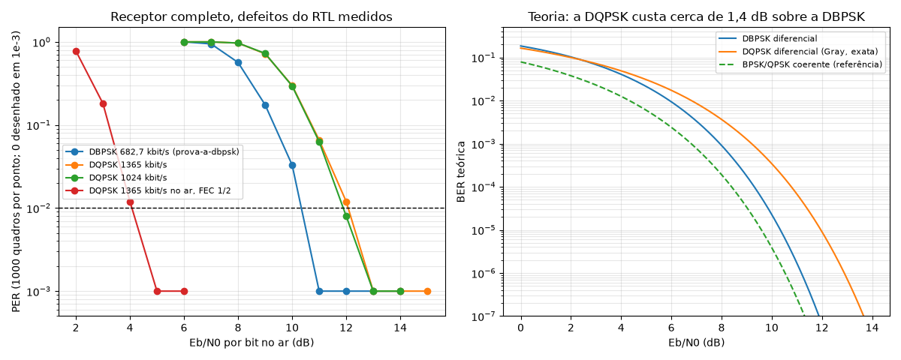

# Etapa 6d: DQPSK para a prova A (em software)

Requisitos: MOD-04 (QPSK, opcional), CMP-A (maior goodput com PER de até 1% e banda de até 1 MHz).

Feito em 22/11/2026, sem hardware (bloco 10).

## 1. Resultado

| Item | Resultado |
|---|---|
| Modulação nova | **DQPSK**: 2 bits por símbolo, mapa de Gray, giros de fase de 0, 90, 180 e 270 graus, detecção diferencial |
| Nova configuração da prova A | **DQPSK, RRC β = 0,25, 3 amostras por símbolo: 1 365 kbit/s no corpo do quadro**, mesma banda da DBPSK (747 kHz) (perfil `prova-a`) |
| Goodput sem perdas | **1 193 kbit/s, 1,93 vez** os 619 kbit/s da DBPSK do bloco 07 (quadro v3) |
| Custo | 1,7 dB a mais de Eb/N0 para PER de 1% (12,1 contra 10,3 dB); 4,8 dB a mais de C/N0 |
| Margem estimada na bancada de 04/11 | **4,9 dB** (a DBPSK tem 9,6 dB) |
| Prova de 60 s simulada | **passa**: PER de 0,06%, goodput de **1 192 kbit/s**, banda medida de 748,7 kHz, RX em 75 s (seção 5) |
| Achado sério | a sequência de 16 bits dava a volta dentro dos 60 s; virou o **quadro v3, com 24 bits** (seção 8) |
| Reserva | a DBPSK do bloco 07 ficou como `prova-a-dbpsk`, com uma regra de troca (seção 6) |
| Simulação × teoria | a BER da DQPSK bate com a fórmula exata (Marcum) a 0,5%: razão 1,003 a 6 dB e 1,005 a 9 dB em 3 milhões de bits |

## 2. Por que DQPSK

A pontuação da prova A é normalizada pelo maior goodput entre as equipes. Com 3 amostras por símbolo a DBPSK já usa a maior taxa de símbolos que cabe em 1 MHz (bloco 07): com 2 amostras a banda passa de 1 MHz. O único jeito de subir mais é levar **mais bits por símbolo**, na mesma banda.

- A **QPSK coerente** não serve pelo mesmo motivo que a BPSK coerente (Etapa 4): o offset residual gira a fase dentro do quadro.
- A **DQPSK** é a QPSK com detecção diferencial: imune à fase da portadora, como a DBPSK, e com o dobro de bits. A teoria diz que ela custa cerca de 2,3 dB em relação à QPSK coerente, ou cerca de 1,4 dB em relação à DBPSK, na mesma BER.
- Pelo C/N0 da bancada (78,3 dB-Hz) a DQPSK a 1 365 kbit/s teria Eb/N0 de cerca de 16,9 dB, contra uns 12 dB necessários: sobra margem.

## 3. Como foi feito

**Só o corpo do quadro vai em DQPSK.** O preâmbulo e o Barker-13 continuam um bit por símbolo, como na DBPSK. Assim:
- a forma de onda do prefixo é **idêntica** à da DBPSK (teste: diferença menor que 10⁻¹²), e a detecção, a estimativa de offset e a de instante não mudam;
- o corpo continua a fase diferencial a partir do último símbolo do sync;
- um quadro de 128 bytes ocupa 29 + 540 = 569 símbolos (mais 13 da cauda do RRC no fluxo), contra 1 109 + 13 na DBPSK.

**Mapa de Gray** dos giros: 00 → 0°, 01 → 90°, 11 → 180°, 10 → 270°. Vizinhos diferem em um bit, então o erro mais provável (um giro de 90° a mais ou a menos) custa um bit só.

**Detecção.** Com w = z_k·conj(z_k−1) (z: saída do filtro casado no instante do símbolo), w·e^(jπ/4) cai em 45°, 135°, 225° ou 315° para 00, 01, 11 e 10: o primeiro bit é 1 quando Im < 0 e o segundo quando Re < 0. A saída suave (para o FEC) é −Im e −Re. A DBPSK virou o caso particular em que todos os bits vão um por símbolo, e as duas usam a mesma função.

**O que mudou no código:**

| Onde | O quê |
|---|---|
| `sdrlink/modem.py` | `dqpsk`, `GIROS_DQPSK`, `bits_por_simbolo`, `simbolos()` e `bits_em()` (conversão com o prefixo a um bit por símbolo); `modular`, `demodular` e `demodular_suave` com `prefixo` |
| `sdrlink/receptor.py` | contas de amostras por símbolos; **o filtro de detecção usa a taxa de símbolos** (pela taxa de bits ele ficaria com o dobro da largura) |
| `sdrlink/transmissor.py`, `sdrlink/config.py` | taxa de bits = taxa de símbolos × bits por símbolo; `--taxa-bits` vira sps pela modulação |
| `sdrlink/teoria.py` | `ber_dqpsk`: Q1(a, b) − ½ I0(ab) exp(−(a² + b²)/2), a² = 2γ(1 − 1/√2), b² = 2γ(1 + 1/√2) |

## 4. Ensaio

`ensaios/etapa6/prova_a_dqpsk_ensaio.py`: mesmo canal da Etapa 6a (offset de −1,4 kHz, atraso de 0,37 amostra, DC, imagem IQ a −45 dBc), 1 000 quadros por ponto, receptor completo. Eb/N0 por bit no ar.

| Candidata | Banda a 99% | Goodput sem perdas | PER a 11 / 12 / 13 dB | Eb/N0 para PER 1% | C/N0 necessário | Margem na bancada | RX (s por s) |
|---|---|---|---|---|---|---|---|
| DBPSK 682,7 kbit/s (`prova-a-dbpsk`) | 749 kHz | 619 kbit/s | 0,1% / 0,1% / 0 | 10,3 dB | 68,7 dB-Hz | 9,6 dB | 1,05 |
| **DQPSK 1 365 kbit/s (`prova-a`)** | **747 kHz** | **1 193 kbit/s** | 6,6% / 1,2% / 0,1% | **12,1 dB** | 73,4 dB-Hz | **4,9 dB** | 1,11 |
| DQPSK 1 024 kbit/s | 563 kHz | 895 kbit/s | 6,3% / 0,8% / 0 | 11,9 dB | 72,0 dB-Hz | 6,3 dB | 1,08 |
| DQPSK 1 365 kbit/s no ar com FEC | 747 kHz | 620 kbit/s | 18,2% a 3 dB, 1,2% a 4 dB, 0 a 5 dB | 4,0 dB | 65,4 dB-Hz | 12,9 dB | **6,88** |

Nenhum pacote errado foi aceito em nenhuma candidata.

- **A DQPSK custou 1,7 dB de Eb/N0** nesta rodada. A mesma configuração, com o quadro v2, tinha dado 1,3 dB, e a teoria dá cerca de 1,4 dB entre as duas detecções diferenciais. A diferença entre as duas rodadas é a flutuação de 1 000 quadros por ponto (cerca de ±0,2 dB em cada curva).
- **A DQPSK a 1 024 kbit/s** (4 amostras por símbolo, 563 kHz) não compensa: precisa de quase o mesmo Eb/N0 e dá 25% menos goodput. A banda menor só ajudaria se a de 747 kHz ficasse perto do limite na medição do RTL.
- **A DQPSK com FEC** dá o mesmo goodput da DBPSK (620 contra 619 kbit/s) com **3,3 dB a menos de C/N0** (65,4 contra 68,7 dB-Hz): seria uma reserva melhor que a DBPSK. Mas o RX levou **6,9 s por segundo de captura**, cerca de 7 minutos para a prova de 60 s, perto do limite de 10 minutos e num computador que ainda não conheço. O gargalo é o Viterbi, que hoje decodifica um quadro por vez num laço em Python. Fica como próximo passo: decodificar muitos quadros de uma vez (os 64 estados de todos os quadros na mesma operação do NumPy) deve tirar o laço do caminho. **Feito no bloco 11** ([etapa6_viterbi_lote.md](etapa6_viterbi_lote.md)): o RX caiu para cerca de 1,5 s por segundo, e a DQPSK com FEC virou a reserva 1 da prova A (`prova-a-fec`).

## 5. Prova de 60 s simulada

`ensaios/etapa6/prova_a_60s_ensaio.py 13 prova-a`: os comandos da prova (`gerar_payloads.py`, `transmitir.py --perfil prova-a --simular`, canal em blocos, `receber.py --perfil prova-a`, `avaliar.py`), a 13 dB por bit no ar (1,3 dB acima do necessário).

| Item | Resultado | Limite da prova |
|---|---|---|
| Pacotes transmitidos (log do TX) | 69 898 (mais de 65 536: só cabe com a sequência de 24 bits) | |
| Recebidos certos | **69 858** | |
| PER | **0,06%** | até 1% |
| Goodput | **1 192,2 kbit/s** (1,93 vez a DBPSK) | maior possível |
| Conteúdo diferente / espúrios / duplicados | **0 / 0 / 0** | |
| Banda a 99% medida na captura | **748,7 kHz** | até 1 MHz |
| Tempo do RX para a captura de 61,5 s | **75,4 s** | até 10 min |
| Tempo do TX para gerar os 60 s e gravar o arquivo | 46,0 s | tempo real |

**A prova A com DQPSK passa em simulação, com os comandos e o perfil da prova.** O goodput é 99,9% dos 1 193 kbit/s sem perdas: a diferença é a PER de 0,06%.

Antes dessa rodada houve duas que falharam e estão na seção 8: uma com payloads de menos no ensaio e outra com a sequência de 16 bits dando a volta.

## 6. Decisão e regra de troca na bancada

**O perfil `prova-a` passou a ser a DQPSK.** A margem cai de 9,6 para 4,9 dB, mas o goodput quase dobra, e a pontuação é relativa ao melhor goodput entre as equipes.

Os 4,9 dB vêm de uma bancada de 04/11, com potência e distância que podem ser diferentes das da prova, e não incluem ruído de fase, desequilíbrio IQ real nem interferência. (Bloco 21: o ruído de fase do par Pluto + RTL, medido nos tons de 04/11, não tem efeito detectável em nenhum perfil, com folga de 16 a 31 vezes; ver [etapa6_imperfeicoes.md](etapa6_imperfeicoes.md).) A DQPSK é mais sensível a todos eles que a DBPSK, porque os pontos da constelação estão a 90° e não a 180°. Por isso a regra, para aplicar na bancada antes da prova:

1. Transmitir 10 s com o perfil `prova-a` e processar: o `receber.py` mede o Eb/N0 da captura.
2. **Se o Eb/N0 medido for de pelo menos 15 dB** (3 dB acima dos 12,1 dB necessários) **e a PER for de até 0,5%**: fica a DQPSK.
3. Senão: `--perfil prova-a-dbpsk` (10,3 dB necessários).

**Atualização (bloco 11):** a regra ganhou um degrau intermediário, a DQPSK com FEC (`prova-a-fec`), com o mesmo goodput da DBPSK e 3,3 dB a mais de margem. A regra atual está no [roteiro da prova](roteiro_da_prova.md), seção 3.1, que depois ganhou a 8-PSK e o perfil a 2,4 MS/s como opções condicionais (blocos 17 e 24).

## 7. Testes

Total do projeto: 224 testes. Novos: ida e volta da DQPSK com e sem prefixo em vários comprimentos (inclusive corpo ímpar), mapa de Gray e prefixo igual ao da DBPSK, BER contra a teoria e independência da fase, saída suave com o sinal da decisão dura, receptor com offset, atraso e emendas (256 ksímbolos/s) e na configuração da prova A (com e sem FEC, payloads de 128 e 60 bytes), filtro e modelo pela taxa de símbolos, fluxo do TX ao RX, perfil DQPSK pela linha de comando, e o teste de ponta a ponta com `--perfil prova-a`, que agora é DQPSK.

| Mutante | Testes que falham |
|---|---|
| Mapa natural em vez de Gray | 13 |
| Saída suave sem o giro de π/4 | 11 |
| Os dois bits do par trocados | 13 |
| Modulador ignora o prefixo | 12 |
| Corpo ímpar sem o bit de enchimento | 6 |
| Filtro de detecção pela taxa de bits | 1 (teste criado para ele) |
| Janela máxima contada em símbolos como se fossem bits | 2 |
| TX sem o prefixo a um bit por símbolo | 1 (sobreviveu à primeira versão; teste do fluxo do TX ao RX criado para ele) |
| Taxa do TX, conversão e taxa do perfil sem os 2 bits por símbolo | 1, 1 e 1 |
| BER teórica sem o termo de Bessel | 2 |

## 8. Achados no caminho

1. **A sequência de 16 bits dava a volta dentro dos 60 s (o achado mais sério do bloco).** A primeira prova de 60 s com DQPSK transmitiu 70 379 pacotes, mais que os 65 536 números de 16 bits. Os números se repetiram, e o avaliador, que casa os pacotes pela sequência, contou 4 839 recebidos com "conteúdo diferente": PER de 6,9%. Na prova isso seria desclassificação. A Etapa 3 tinha descartado o risco ("só acima de 1 100 pacotes por segundo, não atingível com 1 MHz"), e a DQPSK passou disso. Correção: **quadro v3, sequência de 24 bits** (1 117 bits por quadro de 128 bytes, 0,7% de goodput). Registro da rodada que falhou: `dados/logs/prova_a_60s_13dB_20261122_110647_quadro_v2_sequencia_volta.json`.
1. **O ensaio de 60 s gerava só 60 000 payloads**, menos do que a DQPSK manda em 60 s: na rodada antes dessa o TX ficou sem payloads aos 51 s (60 000 pacotes, goodput de 1 023 kbit/s). Passou para 100 000. Na prova o arquivo vem do avaliador: o roteiro da prova confere se ele tem payloads para os 60 s.
1. **Três testes passavam pela semente.** A mudança do quadro trocou os bits de todos os quadros simulados e três testes falharam: o centro da banda medida (flutua de 243,9 a 251,4 kHz em 10 sementes, e o teste exigia ±5 kHz), a GFSK com pico de DC (o quadro perdido some igual sem o pico: é o ruído de 13 dB, não o DC) e o instante dos quadros com FEC a 9 dB (até 0,57 amostra em 10 sementes, contra um limite de 0,4). Os três foram reescritos a partir da distribuição medida, e o teste do DC passou a comparar com e sem o pico; ele continua pegando o defeito A23.

1. **O teste antigo da estimativa de offset passava por sorte.** Ele exigia erro menor que 300 Hz em cada quadro. Medi 40 quadros a 14 dB: o erro tem desvio de cerca de 150 Hz tanto na DBPSK quanto na DQPSK, com máximo de cerca de 400 Hz. É o limite de estimar o offset com um prefixo de 29 símbolos, e 300 Hz são uns 2 desvios. O teste passou a exigir mediana abaixo de 150 Hz e máximo abaixo de 500 Hz. Na detecção diferencial esse erro custa menos de 0,6° por símbolo.
1. **A fórmula da DQPSK não é sempre pior que a da DBPSK.** Abaixo de uns 2,5 dB a DQPSK erra menos bits; o teste compara as duas só nas faixas certas.

## 9. Evidências

| Evidência | Onde |
|---|---|
| Varredura | `ensaios/etapa6/prova_a_dqpsk_ensaio.py`, `dados/logs/prova_a_dqpsk_20261122_111533.json`, `dados/logs/prova_a_dqpsk_execucao.log` |
| Prova de 60 s | `ensaios/etapa6/prova_a_60s_ensaio.py`, `dados/logs/prova_a_60s_13dB_20261122_111755.json` (as rodadas que falharam: `..._110647_quadro_v2_sequencia_volta.json` e `prova_a_dqpsk_60s_quadro_v2_execucao.log`), `dados/logs/prova_a_dqpsk_60s_execucao.log` |
| Figura | `docs/figuras/etapa6_dqpsk.png` (`ensaios/etapa6/figuras_dqpsk_ensaio.py`) |
| Código e testes | `sdrlink/modem.py`, `sdrlink/teoria.py`, `sdrlink/receptor.py`, `tests/test_modem.py`, `tests/test_receptor.py`, `tests/test_transmissor.py`, `tests/test_config.py` |
