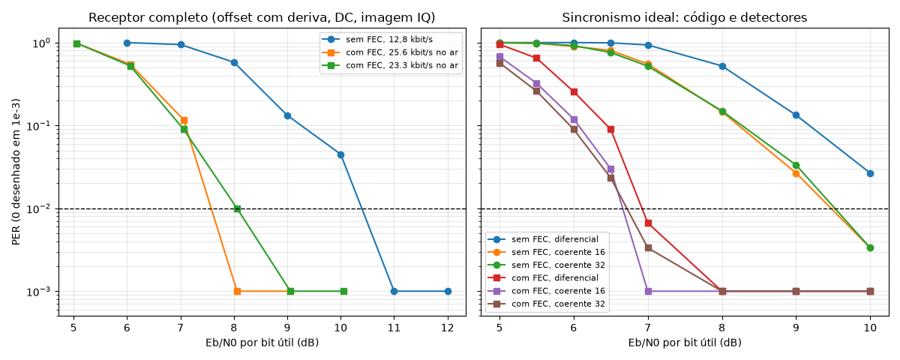

# Etapa 6c: FEC para a prova B (em software)

Requisitos: CMP-B (alcance) e seção 7 do enunciado ("repetição de pacotes e FEC são permitidas, mas o custo delas aparece no goodput").

Feito em 22/11/2026, sem hardware (bloco 09).

> **Nota (bloco 10): quadro v3.** Com a sequência de 24 bits o quadro com FEC passou de 2 185 para 2 201 bits (2 214 tempos de bit no fluxo). O goodput sem perdas do `prova-b` fica em **11,84 kbit/s**, com folga de **17,2%** sobre os 10 kbit/s com PER de 1%.

## 1. Resultado

| Item | Resultado |
|---|---|
| Código | **convolucional K = 7, taxa 1/2, geradores 171 e 133 (octal)**, o padrão do CCSDS e da NASA desde as Voyager; decodificação de **Viterbi com decisão suave** |
| Onde entra | só no corpo do quadro (comprimento, sequência, payload, CRC e 6 bits de cauda); preâmbulo, Barker-13 e guarda não mudam, então a detecção é a mesma |
| Nova configuração da prova B | **DBPSK com FEC a 25,6 kbit/s no ar** (perfil `prova-b`): goodput sem perdas de 11,93 kbit/s, folga de 18,1% sobre os 10 kbit/s com PER de 1%, 500 pacotes em 42,9 s |
| C/N0 necessário | **48,4 dB-Hz**, contra 51,3 dB-Hz sem código (bloco 08): **2,9 dB a menos**, cerca de **1,4 vez a distância** no espaço livre, com mais folga de goodput |
| Sobre a prova A | 20,2 dB a menos de C/N0 que o perfil `prova-a`: cerca de 10 vezes a distância |
| Pacotes errados aceitos | 0 |

## 2. Por que FEC

Na prova B o goodput mínimo é de 10 kbit/s. Sem código, a taxa não pode baixar de cerca de 11,1 kbit/s, e a sensibilidade para aí (bloco 08). Um código de taxa 1/2 dobra a taxa no ar para o mesmo goodput, o que custa 3 dB de Eb/N0 por bit no ar, mas o ganho do código é maior que esse custo.

Escolhi o convolucional K = 7 porque:
- ganha cerca de 5 dB na BPSK com decisão suave, a BER de 10⁻⁵;
- o Viterbi com 64 estados cabe em NumPy: cerca de 12 ms por quadro, vetorizado nos estados;
- é o código de referência da área, com curvas publicadas para conferir a implementação.

## 3. Validação do código

| Teste | Resultado |
|---|---|
| Codificador contra uma implementação direta, bit a bit (registro de deslocamento e paridades) | iguais em 1, 2, 7, 64 e 1 070 bits |
| Resposta ao impulso | 11 10 11 11 00 01 11: **peso 10, a distância livre do código** |
| Qualquer combinação de 4 erros na palavra de 1 bit (2 × 1 001 casos) | todas corrigidas. Distância 10 corrige até 4 erros. É o teste que pega um Viterbi que não parte do estado zero ou que ignora a cauda: esses mutantes erram 633 e 480 dos 2 002 casos |
| BER com decisão suave na BPSK, 3 dB | cerca de 4·10⁻⁴, na curva publicada (sem código: 2,3·10⁻²) |
| 86 erros duros espalhados em 2 152 bits | corrigidos |

## 4. Ganho do código com sincronismo ideal

`ensaios/etapa6/fec_sincronismo_ideal_ensaio.py`: o quadro é modulado e recebido sem o receptor, com instante e fase do início conhecidos e um offset que sobra de 0,002 ciclo por símbolo. Assim separo o ganho do código das perdas do receptor real.

| Eb/N0 por bit útil | 5,0 | 5,5 | 6,0 | 6,5 | 7,0 | 8,0 | 9,0 | 10,0 | Cruza PER 1% |
|---|---|---|---|---|---|---|---|---|---|
| sem FEC, diferencial (o do projeto) | 100% | 100% | 100% | 99,3% | 93,7% | 52,3% | 13,3% | 2,7% | acima de 10 dB (o receptor completo: 10,3 dB) |
| sem FEC, coerente 16 | 100% | 98,0% | 90,0% | 80,3% | 55,3% | 14,7% | 2,7% | 0,3% | 9,5 dB |
| sem FEC, coerente 32 | 99,3% | 98,3% | 92,0% | 76,0% | 52,0% | 15,0% | 3,3% | 0,3% | 9,5 dB |
| **com FEC, diferencial (o do projeto)** | 95,3% | 65,0% | 25,7% | 9,0% | 0,7% | 0 | 0 | 0 | **6,9 dB** |
| com FEC, coerente 16 | 68,0% | 32,3% | 12,0% | 3,0% | 0 | 0 | 0 | 0 | 6,6 dB |
| com FEC, coerente 32 | 57,0% | 26,0% | 9,0% | 2,3% | 0,3% | 0 | 0 | 0 | 6,7 dB |

- **O código ganha cerca de 3,4 dB** com a detecção do projeto (6,9 dB contra cerca de 10,3 dB). É menos que os 5 dB da BPSK coerente: a detecção diferencial multiplica duas amostras ruidosas, e isso pesa justamente no regime de pouca SNR por bit em que o código trabalha.
- **A detecção coerente** (fase estimada pela média móvel de z², que tira a modulação da BPSK, e decodificação diferencial) ganharia 0,8 dB sem código, mas **só 0,3 dB com FEC**.
- **O receptor real perde 0,5 dB** em relação ao ideal (7,4 dB contra 6,9 dB por bit útil, seção 5).

## 5. FEC no receptor completo



`ensaios/etapa6/prova_b_fec_ensaio.py`, mesmo canal do bloco 08 (offset que deriva 35 Hz/s, DC, imagem IQ), 400 quadros por ponto:

| Eb/N0 no ar | 2 dB | 3 dB | 4 dB | 5 dB | 6 dB |
|---|---|---|---|---|---|
| PER, FEC a 25,6 kbit/s | 98,3% | 54,8% | 11,8% | 0 | 0 |
| Quadros detectados (de 400) | 165 | 298 | 361 | 400 | 403 |

| Configuração | Eb/N0 para PER 1% | C/N0 necessário | Folga de goodput |
|---|---|---|---|
| DBPSK 12,8 kbit/s sem código (bloco 08) | 10,3 dB | 51,3 dB-Hz | 15,7% |
| DBPSK 11,6 kbit/s sem código (`prova-b-limite`) | 10,1 dB | 50,8 dB-Hz | 5,1% |
| **DBPSK 25,6 kbit/s no ar com FEC** | **4,35 dB** (7,4 dB por bit útil) | **48,4 dB-Hz** | **18,1%** |
| DBPSK 23,3 kbit/s no ar com FEC | 5,0 dB | 48,7 dB-Hz | 7,3% |

**A detecção virou o gargalo.** Com FEC cada bit no ar leva metade da energia, e o prefixo de 29 bits, que não é codificado, fica 3 dB mais fraco. A 4 dB no ar só 361 dos 400 quadros são achados: das 47 perdas, 39 são de detecção e 8 de decodificação. É o que separa os 2,9 dB medidos aqui do ganho do código sozinho (seção 4).

## 6. O que fica para melhorar

| Melhoria | Ganho medido ou estimado | Por que não agora |
|---|---|---|
| Detecção coerente (fase pela média de z²) | 0,3 dB com FEC, 0,8 dB sem com sincronismo ideal (seção 4) | uma fase mal estimada derruba o quadro inteiro, e o ruído de fase do Pluto e do RTL no ar ainda não foi medido |
| Prefixo mais longo nos quadros com FEC | cerca de 0,5 dB: recupera a detecção perdida (seção 5) | muda o formato do quadro e o modelo do receptor; vale depois de medir no ar quanto a detecção perde de fato |
| 23,3 kbit/s no ar | nenhum: precisou de mais C/N0 que 25,6 kbit/s, dentro da flutuação de 400 quadros | a folga de goodput cai para 7,3% |

## 7. Como usar

```
python scripts/transmitir.py payloads.bin --perfil prova-b
python scripts/receber.py <captura>.npy --perfil prova-b
```

`--fec` liga e `--no-fec` desliga o código em qualquer perfil. O `prova-b-sem-fec` guarda a configuração do bloco 08. Com FEC o `receber.py` registra o Eb/N0 por bit no ar (o medido na captura) e por bit útil (3 dB acima). O tempo de processamento do RX na prova B foi de 0,49 s por segundo de captura; o Viterbi pesa mais na prova A (DQPSK com FEC, bloco 10).

## 8. Implementação

| Onde | O quê |
|---|---|
| `sdrlink/codigo.py` | `codificar`, `decodificar` (Viterbi), `bits_codificados` |
| `sdrlink/modem.py` | `demodular_suave`: um valor por bit, positivo para 1; `demodular` passou a ser o sinal dele (as 172 provas anteriores continuaram passando) |
| `sdrlink/quadro.py` | `montar_quadro(pacote, fec)`, `bits_no_ar_apos_sync`, `bits_por_quadro(n, fec)` |
| `sdrlink/receptor.py` | `ConfigReceptor.fec`; o leitor decodifica a janela de 128 bytes, relê se o comprimento decodificado for maior e encolhe a janela perto do fim da captura |
| `sdrlink/transmissor.py`, `sdrlink/config.py`, scripts | `fec` no TX, no RX, nos perfis e na linha de comando |

**Defeito achado e corrigido no caminho:** a primeira versão do leitor com FEC usava sempre a janela de 128 bytes e perdia um quadro curto no fim da captura, porque a janela passava do fim do arquivo. Na prova isso não aconteceria (payload sempre de 128 bytes, gravação contínua), mas o leitor passou a usar a maior janela que cabe. Tem teste próprio, que falha na versão antiga.

## 9. Testes

Total do projeto: 198 testes. Novos: `tests/test_codigo.py` (7 testes, 11 casos), FEC no quadro, no modem (saída suave com o sinal da decisão dura em cada modulação), no transmissor, no receptor (tamanhos 40, 128 e 200 bytes com emendas; FEC recebe onde sem código falha; captura curta; quadro curto no fim) e nos perfis e scripts (`--fec` de ponta a ponta).

| Mutante | Testes que falham |
|---|---|
| Gerador trocado (133 por 131) | 1 |
| Viterbi sem partir do estado zero | 1 (sobreviveu à primeira versão; pego pelo teste exaustivo dos 4 erros) |
| Traceback pelo melhor estado, ignorando a cauda | 1 (idem) |
| Saída suave da DBPSK com o sinal trocado | 15 |
| Saída suave da OOK sem o limiar | 8 |
| RX sem a releitura com o comprimento decodificado | 1 |
| RX ignora o FEC | 3 |
| Janela máxima do RX sem o FEC | 3 |
| Quadro com FEC sem codificar | 5 |
| Período do quadro ignora o FEC | 1 |
| `receber.py` e `transmitir.py` não passam o FEC do perfil | 1 e 1 |
| Perfil aceita `fec = 1` | 1 |

## 10. Evidências

| Evidência | Onde |
|---|---|
| FEC no receptor completo | `ensaios/etapa6/prova_b_fec_ensaio.py`, `dados/logs/prova_b_fec_20261122_104747.json`, `dados/logs/prova_b_fec_execucao.log` |
| Sincronismo ideal | `ensaios/etapa6/fec_sincronismo_ideal_ensaio.py`, `dados/logs/fec_sincronismo_ideal_20261122_105017.json`, `dados/logs/fec_sincronismo_ideal_execucao.log` |
| Figura | `docs/figuras/etapa6_fec.png` (`ensaios/etapa6/figuras_fec_ensaio.py`) |
| Código e testes | `sdrlink/codigo.py`, `tests/test_codigo.py` e os módulos da seção 8 |
