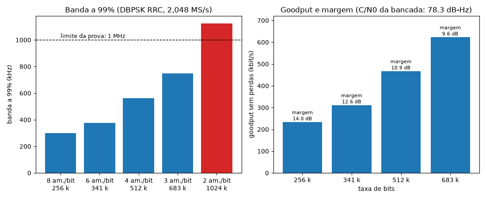
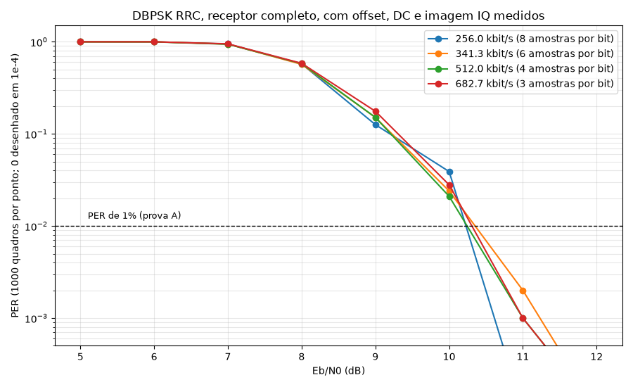

# Etapa 6a: configuração da prova A (em software)

Requisitos: CMP-A (maior goodput com PER de até 1% e banda a 99% de até 1 MHz), PRC-01 e achado A14 (parâmetros configuráveis e iguais no TX e no RX), CMP-B (configuração registrada em cada posição).

Feito em 22/11/2026, sem hardware. Falta confirmar na bancada (seção 6).

## 1. Resultado

| Item | Resultado |
|---|---|
| Configuração escolhida | **DBPSK, RRC com β = 0,25, 3 amostras por bit a 2,048 MS/s: 682,7 kbit/s**, sinal deslocado de +425 kHz do LO (perfil `prova-a` até o bloco 09). **Atualização (bloco 10):** o perfil `prova-a` passou a ser a DQPSK a 1 365 kbit/s, com quase o dobro do goodput ([etapa6_dqpsk.md](etapa6_dqpsk.md)); esta configuração ficou como `prova-a-dbpsk`, a reserva |
| Goodput sem perdas | **623 kbit/s**, 2,7 vezes os 234 kbit/s da configuração da Etapa 5 (256 kbit/s) e cerca de 85 vezes a OOK de referência (7,3 kbit/s com o quadro dela, medido na captura de 04/11) |
| Goodput na prova de 60 s simulada | **622,1 kbit/s** com PER de 0,15% (seção 4) |
| Banda a 99% | **749 kHz** (limite: 1 MHz), de +50 a +800 kHz do LO: longe do DC do RTL e dentro da faixa em que a resposta dele é plana |
| Eb/N0 para PER de 1% | **10,3 dB**, o mesmo da taxa de 256 kbit/s: o receptor não perde nada com 3 amostras por bit |
| Margem estimada na bancada | **9,6 dB** (C/N0 de 78,3 dB-Hz medido na captura real de 04/11) |
| Prova de 60 s simulada | **passa**: PER de 0,15%, goodput de 622,1 kbit/s, banda medida de 749,6 kHz, RX em 80 s (seção 4) |
| Perfis de configuração | `configs/perfis.toml`: o TX, a gravação e o RX recebem `--perfil prova-a` e usam os mesmos parâmetros; fecha o achado A14 |

## 2. Por que essa configuração

O goodput é proporcional à taxa de bits. Cada quadro tem 1 109 bits, mas ocupa **1 122 tempos de bit** no fluxo do TX: depois do último bit vem a cauda do pulso RRC, que dura mais 13 tempos de bit. São 1 024 bits úteis em 1 122, ou seja, 91,3% da taxa quando a PER é zero. A prova A premia então a maior taxa que caiba em 1 MHz e ainda tenha Eb/N0 suficiente.

Com a taxa de amostragem de 2,048 MS/s, as amostras por bit precisam ser inteiras (restrição do receptor e do TX), e as taxas possíveis são 2,048 MS/s dividido por 8, 6, 5, 4, 3 ou 2.



### 2.1 Banda

| Amostras por bit | Taxa (kbit/s) | β | Banda a 99% | Cabe em 1 MHz? |
|:-:|---|:-:|---|:-:|
| 8 | 256 | 0,35 | 299 kHz | sim |
| 6 | 341,3 | 0,25 | 375 kHz | sim |
| 4 | 512 | 0,25 | 563 kHz | sim |
| **3** | **682,7** | **0,25** | **749 kHz** | **sim, com 251 kHz de folga** |
| 2 | 1 024 | 0,25 | 1 123 kHz | **não** |

Com 2 amostras por bit a banda passa de 1 MHz mesmo com β = 0,25, e baixar mais o β para caber exigiria β perto de 0,1, com pulso longo e muito sensível ao erro de temporização. **A maior taxa possível a 2,048 MS/s é 682,7 kbit/s.**

### 2.2 Fator de rolagem

Com 3 amostras por bit, mesmos quadros e mesmo ruído:

| β | Banda a 99% | PER a 8 dB | PER a 9 dB |
|:-:|---|---|---|
| 0,20 | 735 kHz | 57,2% | 19,5% |
| **0,25** | **749 kHz** | 54,9% | 16,7% |
| 0,35 | 792 kHz | 55,5% | 14,7% |

A diferença de PER entre os três é de menos de 0,2 dB, perto da flutuação de 1 000 quadros. **Escolhi β = 0,25:** 43 kHz a mais de folga na banda que β = 0,35, e o RRC fica menos longo que com 0,20. A banda é eliminatória, e a diferença de PER é desprezível.

### 2.3 PER do receptor completo



Cada ponto tem 1 000 quadros de 128 bytes, um atrás do outro como na prova, recebidos pelo receptor completo (detecção, offset, instante e demodulação estimados quadro a quadro), com os defeitos do enlace real **medidos na captura de 04/11**:
- offset de −1,4 kHz e atraso fracionário de 0,37 amostra;
- DC de 0,008 do valor eficaz;
- imagem IQ a −45 dBc.

| Amostras por bit | 8 dB | 9 dB | 10 dB | 11 dB | 12 dB | Eb/N0 para PER 1% | Pacotes errados aceitos |
|:-:|---|---|---|---|---|---|:-:|
| 8 | 57,6% | 12,6% | 3,9% | 0 | 0 | 10,2 dB | 0 |
| 6 | 56,9% | 15,1% | 2,4% | 0,2% | 0 | 10,4 dB | 0 |
| 4 | 57,9% | 15,1% | 2,1% | 0,1% | 0 | 10,2 dB | 0 |
| **3** | 58,4% | 17,6% | 2,8% | 0,1% | 0 | **10,3 dB** | **0** |

As quatro curvas ficam juntas, a menos de 0,2 dB. Com menos amostras por bit o filtro de detecção, o interpolador do instante (seção 10 de [etapa3_receptor.md](etapa3_receptor.md)) e a estimativa de offset continuam funcionando.

### 2.4 Margem diante da bancada

Na captura real de 04/11 (Pluto da equipe → RTL, na bancada) o C/N0 foi de **78,3 dB-Hz**: a potência da OOK de referência acima do piso de ruído, dividida pela densidade do piso. O Eb/N0 numa taxa Rb é C/N0 − 10 log₁₀(Rb):

| Taxa | Eb/N0 na bancada | Necessário | Margem |
|---|---|---|---|
| 256 kbit/s | 24,2 dB | 10,2 dB | 14,0 dB |
| 512 kbit/s | 21,2 dB | 10,2 dB | 10,9 dB |
| **682,7 kbit/s** | **19,9 dB** | **10,3 dB** | **9,6 dB** |

Cuidados com esse número:
- a potência e a distância da prova são padronizadas pelo professor e podem ser diferentes das de 04/11;
- a margem não inclui ruído de fase, não linearidade do Pluto, interferência na faixa ISM e multipercurso; (Bloco 21: o ruído de fase do par Pluto + RTL, medido nos tons de 04/11, não tem efeito detectável em nenhum perfil, com folga de 16 a 31 vezes; ver [etapa6_imperfeicoes.md](etapa6_imperfeicoes.md).)
- por isso o perfil `dbpsk-256k` fica pronto como reserva (14 dB de margem), e a troca leva um parâmetro.

### 2.5 Tempo de processamento e do TX

| Amostras por bit | RX (s por s de captura) | TX (fração do tempo real) |
|:-:|---|---|
| 8 | 1,16 | 0,27 |
| 6 | 1,19 | 0,32 |
| 4 | 1,17 | 0,38 |
| 3 | 1,23 | 0,45 |

Os tempos variam com a carga do computador: nas três rodadas desta etapa o RX ficou entre 0,98 e 1,26 s por segundo, e a prova de 60 s levou de 67 a 80 s. É cerca de 1,5 min, contra o limite de 10 min. O TX gera o sinal a 0,45 vez o tempo real, uma folga de 2,2 vezes para alimentar o Pluto (risco R1 do [etapa3_transmissor.md](etapa3_transmissor.md)). O computador da prova pode ser mais lento, e as duas folgas são grandes o bastante para isso.

### 2.6 Posição do sinal

Medi na captura real de 04/11 a forma do piso de ruído do RTL a 2,048 MS/s: ele é plano, dentro de ±1 dB, de −850 a +850 kHz, e cai 3 dB em ±1 MHz. O DC ficou em 0,008 do valor eficaz e a imagem IQ a −45 dBc.

Com deslocamento de +425 kHz, a banda a 99% vai de +50 a +800 kHz: fora do DC e do vazamento do LO do Pluto (que caem no centro) e dentro da faixa plana. Com o LO em 919,5 MHz o sinal ocupa 919,55 a 920,30 MHz, longe da harmônica de 921,6 MHz do RTL (decisão D5), e a imagem do Pluto (919,08 MHz) também fica dentro de 915 a 928 MHz. O `transmitir.py` confere isso antes de transmitir.

## 3. Perfis de configuração (achado A14)

`configs/perfis.toml` guarda perfis com nome:

| Perfil | Para quê |
|---|---|
| `prova-a` | a configuração desta etapa |
| `dbpsk-256k`, `gfsk-128k`, `ook-128k` | as três modulações da bancada da Etapa 5; o `dbpsk-256k` é também a reserva da prova A |

Uso:

```
python scripts/gravar_iq.py --perfil prova-a --segundos 62 --nome prova_a
python scripts/transmitir.py payloads.bin --perfil prova-a
python scripts/receber.py dados/capturas/prova_a_<carimbo>.npy --perfil prova-a
```

- Um parâmetro dado na linha de comando substitui só aquele campo (por exemplo `--perfil prova-a --taxa-bits 512e3`), e o perfil passa a se chamar `prova-a (alterado)`.
- O JSON de cada script guarda o perfil completo usado, o que atende ao "registrar cada configuração" da prova B.
- O perfil é validado ao ser lido: campo desconhecido, tipo errado, pulso incompatível com a modulação, taxa que não divide a amostragem e LO fora de 915 a 928 MHz são recusados.
- `gravar_iq.py --perfil` usa o LO e a taxa do perfil, os mesmos do TX. O limite de gravação subiu de 60 para 70 s: a gravação começa antes do TX e termina depois do último quadro, então 60 s não bastavam para a prova.

## 4. Prova de 60 s simulada

`ensaios/etapa6/prova_a_60s_ensaio.py` roda os comandos da prova, com o perfil `prova-a`:

1. `gerar_payloads.py --aleatorios 60000`;
2. `transmitir.py --perfil prova-a --duracao-s 60 --simular`;
3. canal em blocos: 1 s de ruído antes, 0,5 s depois, offset, imagem IQ, DC e ruído a 11 dB;
4. `receber.py --perfil prova-a`;
5. `avaliar.py --duracao-s 60`.

O Eb/N0 de 11 dB fica 0,7 dB acima do necessário para PER de 1% e 8,9 dB abaixo do estimado para a bancada de 04/11: um ensaio de prova apertado de propósito.

| Item | Resultado | Limite da prova |
|---|---|---|
| Pacotes transmitidos (log do TX) | 36 507 | |
| Recebidos certos | **36 452** | |
| PER | **0,15%** | até 1% |
| Goodput | **622,1 kbit/s** | maior possível |
| Conteúdo diferente / espúrios / duplicados | **0 / 0 / 0** | |
| Banda a 99% medida na captura pelo `receber.py` | **749,6 kHz** | até 1 MHz |
| Eb/N0 medido na captura | 11,0 dB (o pedido) | |
| Tempo do RX para a captura de 61,5 s | **80,4 s** (67 a 80 s nas três rodadas) | até 10 min |
| Tempo do TX para gerar os 60 s e gravar o arquivo | 35,6 s, menos que os 60 s da prova | tempo real |

**A prova A passa em simulação, com os comandos e o perfil da prova.** O goodput de 622,1 kbit/s é 99,85% dos 623,0 kbit/s sem perdas: a diferença é exatamente a PER de 0,15%.

**Correção feita durante esta etapa:** a primeira versão da varredura calculava o goodput sem perdas com 1 109 bits por quadro e dava 630,3 kbit/s. A prova de 60 s mostrou 36 507 quadros em 60 s, menos que os cerca de 36 930 que essa conta previa. A diferença é a cauda do RRC (13 tempos de bit por quadro, 1,2%). O ensaio passou a usar o período real do quadro no fluxo (`transmissor.amostras_por_quadro`).

**Ganho possível (feito no bloco 12, [etapa6_emenda.md](etapa6_emenda.md)):** emendar a cauda do RRC de um quadro no começo do seguinte, em vez de esperar ela terminar, recupera esses 1,2% (cerca de 7 kbit/s). Fica para depois de confirmar a configuração no ar.

## 5. Testes

Total do projeto: 172 testes. Os novos estão em `tests/test_config.py`:

| Teste | O que garante |
|---|---|
| `test_perfis_do_projeto_sao_validos_e_a_prova_a_cabe_em_1_mhz` | os perfis do projeto carregam; o `prova-a` tem banda abaixo de 0,8 MHz, longe do DC e dentro da faixa plana do RTL |
| `test_linha_de_comando_substitui_so_o_campo_dado` | sem parâmetros, o perfil sai igual; com `--taxa-bits` e `--beta`, só esses campos mudam |
| `test_sem_perfil_exige_modulacao_pulso_e_taxa` | sem perfil, os três parâmetros são obrigatórios e o resto fica no padrão |
| `test_perfil_invalido_e_rejeitado` (9 casos) | arquivo vazio, chave solta, campo desconhecido, tipos errados (inclusive booleano), LO fora da faixa, deslocamento fora da banda, pulso incompatível |
| `test_erros_de_montagem` | perfil inexistente (lista os disponíveis), taxa que não divide a amostragem, campo desconhecido |
| `test_tx_e_rx_com_o_mesmo_perfil_fecham_o_enlace` | `transmitir.py --perfil prova-a --simular` e `receber.py --perfil prova-a`, de verdade: a saída do RX é idêntica ao log do TX, e o JSON registra o perfil |
| `test_scripts_recusam_perfil_inexistente_ou_parametros_faltando` | os scripts param com mensagem clara |

Testes de mutante (cada decisão desligada de propósito):

| Mutante | Testes que falham |
|---|---|
| Linha de comando ignorada (o perfil sai sempre igual) | 1 |
| Sem conferir que a taxa divide a amostragem | 1 |
| LO fora de 915 a 928 MHz aceito | 1 |
| Booleano aceito como número | 1 |
| Campo desconhecido aceito no TOML | 1 |
| Sem exigir modulação e pulso quando não há perfil | 1 |
| RX ignora o deslocamento do perfil | 1 |
| TX ignora o deslocamento do perfil | 1 |
| β do perfil não chega ao modem | 1 |

O último mutante sobreviveu na primeira versão dos testes. Com β = 0,35 a banda do `prova-a` é de 792 kHz, e o teste só exigia menos de 800 kHz. O teste passou a conferir o modem montado pelo perfil e a banda de 749 kHz com tolerância de 5 kHz.

## 6. O que falta na bancada

> **Atualização (blocos 10 a 13):** o `prova-a` hoje é a DQPSK, e a regra de troca na bancada é a do [roteiro da prova](roteiro_da_prova.md), seção 3.1 (hoje: 8-PSK e 2,4 MS/s se a bancada permitir, depois DQPSK, DQPSK com FEC e a DBPSK desta página, que virou o `prova-a-dbpsk`). Os itens abaixo continuam valendo para a DBPSK.

1. Medir a banda a 99% do perfil `prova-a` no RTL (`receber.py` já calcula) e conferir os 749 kHz.
2. Transmitir 60 s com o perfil `prova-a` na distância da prova e avaliar PER e goodput. Se a PER passar de 1%, descer para 512 kbit/s (`--taxa-bits 512e3`) ou para o perfil `dbpsk-256k`.
3. Medir o C/N0 nas condições da prova e refazer a margem da seção 2.4.
4. Conferir que o Python alimenta o Pluto a 2,048 MS/s sem buraco durante os 60 s (risco R1).

## 7. Evidências

Os dois registros foram gerados com o código do commit `bloco-06-5-g33e1b70`, sem nenhuma pendência fora de `dados/` e `docs/`. Duas rodadas anteriores deram os mesmos números (as sementes são fixas) e foram descartadas: uma com a conta antiga do goodput e outra marcada como "suja" porque o documento ainda não tinha commit.

| Evidência | Onde |
|---|---|
| Varredura de taxas, β, PER, margem e tempos | `ensaios/etapa6/prova_a_ensaio.py`, `dados/logs/prova_a_20261122_011645.json`, `dados/logs/prova_a_execucao.log` |
| Prova de 60 s simulada | `ensaios/etapa6/prova_a_60s_ensaio.py`, `dados/logs/prova_a_60s_11dB_20261122_011906.json`, `dados/logs/prova_a_60s_execucao.log` |
| Figuras | `docs/figuras/etapa6_prova_a.png`, `docs/figuras/etapa6_prova_a_per.png` |
| Código e testes | `sdrlink/config.py`, `configs/perfis.toml`, `scripts/transmitir.py`, `scripts/receber.py`, `scripts/gravar_iq.py`, `tests/test_config.py` |
