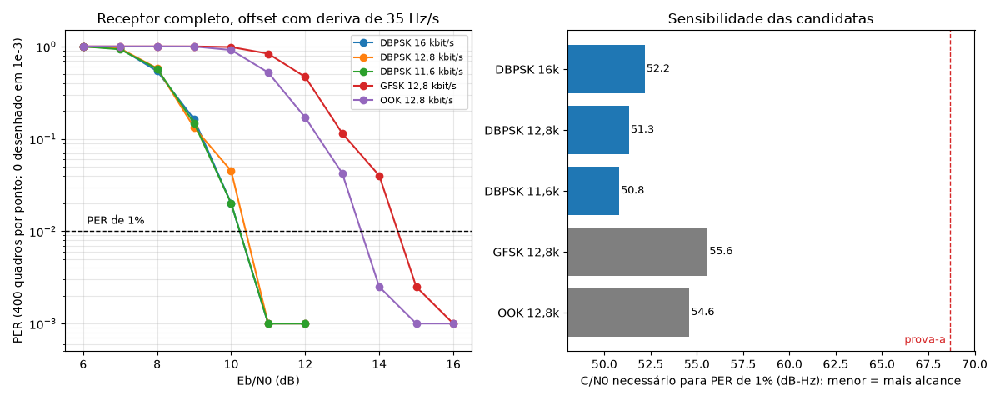

# Etapa 6b: configuração da prova B (em software)

Requisito: CMP-B. Em cada posição, goodput de pelo menos 10 kbit/s, PER de até 1% e pelo menos 500 pacotes transmitidos; vence a maior distância validada.

Feito em 22/11/2026, sem hardware (bloco 08). O bloco 09 acrescenta o FEC sobre esta escolha ([etapa6_fec.md](etapa6_fec.md)).

## 1. Resultado

| Item | Resultado |
|---|---|
| Configuração escolhida | **DBPSK, RRC β = 0,35, 160 amostras por bit a 2,048 MS/s: 12,8 kbit/s**. **Atualização (bloco 09):** com FEC a 25,6 kbit/s no ar a prova B precisa de 2,9 dB a menos, e o perfil `prova-b` passou a ser essa configuração ([etapa6_fec.md](etapa6_fec.md)); a deste bloco ficou como `prova-b-sem-fec` |
| Goodput sem perdas | **11,68 kbit/s**: 15,7% acima do mínimo de 10 kbit/s mesmo com PER de 1% (11,57 kbit/s) |
| Tempo para 500 pacotes | 43,8 s |
| C/N0 necessário para PER de 1% | **51,3 dB-Hz**, contra 68,6 dB-Hz do perfil `prova-a`: **17,3 dB a menos** |
| Alcance relativo, espaço livre | 17,3 dB valem cerca de **7,3 vezes a distância** do perfil `prova-a` |
| Banda a 99% | 15,1 kHz |
| Pacotes errados aceitos | 0 em todas as candidatas |

## 2. Alcance é sensibilidade

A prova B não premia velocidade: em cada posição basta passar dos 10 kbit/s com PER de até 1%. Vai mais longe a configuração que funciona com o **menor C/N0** (potência recebida dividida pela densidade de ruído). No espaço livre a potência cai com o quadrado da distância, então cada 6 dB a menos de C/N0 necessário dobram o alcance.

O C/N0 necessário é o Eb/N0 para PER de 1% somado a 10 log₁₀(Rb). Ganham pontos:
1. **a modulação mais sensível** (menor Eb/N0 para a mesma PER);
2. **a menor taxa** que ainda dá 10 kbit/s de goodput. Com quadros de 1 122 tempos de bit para 1 024 úteis, a taxa mínima é de cerca de 11,1 kbit/s.

A 2,048 MS/s as taxas perto desse piso são 16 kbit/s (128 amostras por bit), 12,8 kbit/s (160) e 11,6 kbit/s (176).

## 3. Ensaio



`ensaios/etapa6/prova_b_ensaio.py`: 400 quadros de 128 bytes por ponto, um atrás do outro, receptor completo, com os defeitos do enlace real:
- offset de −1,4 kHz que **deriva 35 Hz/s**, a pior deriva medida dentro de uma transmissão (achado A18). A 12,8 kbit/s um quadro dura 88 ms, então a deriva importa mais que na prova A;
- DC de 0,008 do valor eficaz e imagem IQ a −45 dBc (medidos na captura de 04/11).

| Candidata | Banda a 99% | Goodput sem perdas | Folga sobre 10 kbit/s (PER 1%) | Eb/N0 para PER 1% | C/N0 necessário | Ganho sobre a prova A |
|---|---|---|---|---|---|---|
| DBPSK 16 kbit/s | 18,8 kHz | 14,60 kbit/s | 44,6% | 10,1 dB | 52,2 dB-Hz | 16,5 dB |
| **DBPSK 12,8 kbit/s** | 15,1 kHz | 11,68 kbit/s | **15,7%** | 10,3 dB | **51,3 dB-Hz** | **17,3 dB** |
| DBPSK 11,6 kbit/s | 13,7 kHz | 10,62 kbit/s | 5,1% | 10,1 dB | 50,8 dB-Hz | 17,9 dB |
| GFSK 12,8 kbit/s | 21,1 kHz | 11,69 kbit/s | 15,8% | 14,5 dB | 55,6 dB-Hz | 13,1 dB |
| OOK 12,8 kbit/s | 14,4 kHz | 11,69 kbit/s | 15,8% | 13,5 dB | 54,6 dB-Hz | 14,1 dB |

PER por ponto e todos os números: `dados/logs/prova_b_20261122_103822.json`.

### 3.1 Escolhas

- **A modulação é a DBPSK.** A GFSK e a OOK precisam de 4,3 dB e 3,3 dB a mais de C/N0 na mesma taxa. É o que a teoria prevê: a 2-FSK não coerente e a OOK perdem cerca de 3 dB para a DBPSK, e o ensaio confirma com o receptor completo.
- **A taxa é 12,8 kbit/s, e não 11,6.** A 11,6 kbit/s o ganho seria de 0,4 dB (10 log₁₀ de 12,8/11,6; o ensaio mostrou 0,5 dB, dentro da flutuação de 400 quadros por ponto), cerca de 5% a mais de distância. Mas a folga de goodput cai para 5,1%: um atraso de 1 s no começo do TX, dentro dos 60 s da janela, já tira 1,7%. A 12,8 kbit/s a folga é de 15,7%. O perfil `prova-b-limite` (11,6 kbit/s) fica pronto para a última posição, quando valer arriscar.
- **Os 500 pacotes levam 43,8 s.** Se a janela da prova B for de 60 s, como a da A, sobra tempo; se for mais curta, a taxa de 16 kbit/s (35,1 s) é a alternativa, por 0,8 dB.

### 3.2 O que a deriva de frequência fez

Nada mensurável. A 12,8 kbit/s a DBPSK precisou do mesmo Eb/N0 que a 256 kbit/s (10,2 dB na Etapa 6a), mesmo com a deriva de 35 Hz/s. Num quadro de 88 ms ela muda o offset em 3 Hz, e a detecção diferencial só sente a mudança de fase entre bits vizinhos (menos de 0,1°).

## 4. Dois defeitos achados no caminho

1. **O ensaio cortava o último quadro da OOK.** A primeira rodada mostrou a OOK presa em PER de 0,25% de 14 a 16 dB. Era sempre o último quadro, lido como "curto". O ensaio cortava a captura na última amostra diferente de zero, e na OOK o bit 0 é silêncio: o corte levava os zeros finais do CRC e a guarda. Numa gravação real o RTL continua gravando, então o defeito era só do ensaio. Corrigido com 0,1 s de ruído depois dos quadros, e a varredura foi refeita. O mesmo cuidado entrou no ensaio do FEC.
2. **A OOK tem detecções falsas em posições fixas** (métrica entre 0,50 e 0,61), sempre com CRC falho. São trechos do payload que lembram o prefixo, porque a OOK tem média diferente de zero. São inofensivas: nenhuma vira pacote aceito, e a supressão de não-máximos fica com o pico verdadeiro (cerca de 0,9). Já tinham aparecido na Etapa 3.

E um cuidado de recurso: a 12,8 kbit/s cada ponto tem 35 s de sinal (72 milhões de amostras). A primeira versão montava o canal com várias cópias em precisão dupla e uma FFT do sinal inteiro, vários GB por ponto. O computador desligou no meio dessa primeira rodada; não sei se foi por isso, mas o risco não valia a pena. O ensaio passou a montar o canal em blocos, direto em complex64 (pico medido de 1,1 GB), e o atraso fracionário saiu, porque a 160 amostras por bit ele é 0,2% de um bit.

## 5. Perfis

```
python scripts/transmitir.py payloads.bin --perfil prova-b-sem-fec
python scripts/gravar_iq.py --perfil prova-b-sem-fec --segundos 62 --nome prova_b_posicao1
python scripts/receber.py dados/capturas/prova_b_posicao1_<carimbo>.npy --perfil prova-b-sem-fec
```

O JSON de cada script guarda o perfil completo, o que atende ao "registrar cada configuração" da prova B.

## 6. O que falta na bancada

1. Medir o C/N0 em cada posição da sala e conferir a margem.
2. Conferir o ruído de fase do Pluto e do RTL a 12,8 kbit/s: num quadro de 88 ms ele pesa mais que na prova A.

## 7. Evidências

| Evidência | Onde |
|---|---|
| Varredura | `ensaios/etapa6/prova_b_ensaio.py`, `dados/logs/prova_b_20261122_103822.json`, `dados/logs/prova_b_execucao.log` |
| Figura | `docs/figuras/etapa6_prova_b.png` (`ensaios/etapa6/figuras_prova_b_ensaio.py`) |
| Perfis | `configs/perfis.toml` (`prova-b-sem-fec`, `prova-b-limite`; o `prova-b` atual é o do bloco 09) |
